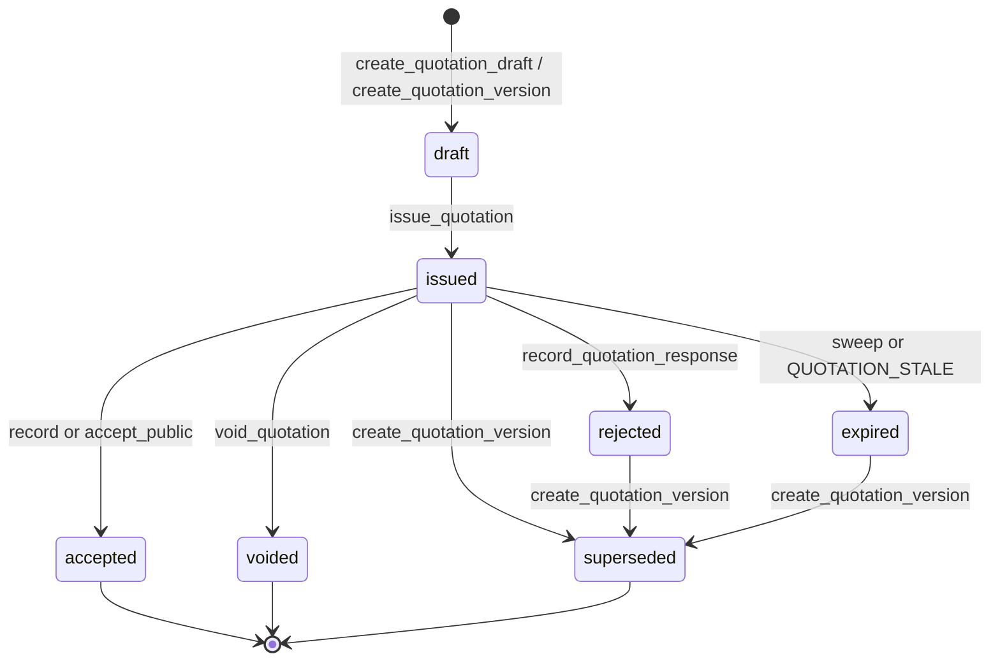

# Quotations & Proposals (005-quotation-proposals)

Module that turns an eligible pre-reservation into a binding commercial proposal with
server-side pricing, a frozen issued amount, a validity window, and a public read-only
client link. The database is the only pricing authority: the panel paints the breakdown
the RPC returns and never sums or multiplies amounts. This module does not create
reservations — feature 006 consumes the accepted quotation.

**Spec**: `specs/005-quotation-proposals/`
**Plan**: `specs/005-quotation-proposals/plan.md`

## What lives where

| Concern | Location |
| --- | --- |
| Quotation enums, adjustment/response types, audit event values | `supabase/migrations/042_quotation_enums.sql` |
| Tables, FKs, triggers, RLS, `quotation_list` view | `supabase/migrations/043_quotations.sql` |
| Internal pricing core (tariff resolution, recalculation, adjustments, fingerprint) | `supabase/migrations/044_quotation_pricing.sql` |
| US1 draft RPCs (`create_quotation_draft`, `recalculate_quotation`, …) | `supabase/migrations/045_us1_quotation_draft.sql` |
| US2 issue, terms/validity, expiry sweep, defaults | `supabase/migrations/046_us2_quotation_issue.sql` |
| US3 public delivery (`get_public_quotation`, WhatsApp text) | `supabase/migrations/047_us3_quotation_delivery.sql` |
| US4 responses, versioning, voiding, 006 boundary | `supabase/migrations/048_us4_quotation_responses.sql` |
| SQL verification | `supabase/tests/quotation_pricing_test.sql`, `quotation_rls_test.sql`, `quotation_issue_test.sql`, `quotation_public_test.sql`, `quotation_version_test.sql` |
| Domain models and services | `src/app/core/quotations/` |
| Panel UI | `src/app/features/sales/quotations/` (list + editor) |
| Public client page | `src/app/features/public-quotation/` |

## Entities

| Entity | Table | Notes |
| --- | --- | --- |
| Family | `quotation_families` | Groups reference `COT-#####`, the public token hash and the pre-reservation. Identity (`pre_reservation_id`, `customer_id`, `created_at`) is immutable; `reference` and `public_token_hash` only go from null to a value. |
| Version | `quotation_versions` | The quotation the agent edits and, while current, the client sees. One open (`draft`/`issued`) and one `accepted` per family (partial unique indexes). Outside `draft` a trigger rejects changes to money, texts, `exchange_rates` and `valid_until` (`QUOTATION_FROZEN`). |
| Line | `quotation_lines` | Snapshot of a pre-reservation item: charge type, basis, tariff, exchange rate, per-line tax (0–100 %), `line_base/adjustment/tax/total` rounded to `numeric(14,2)`. |
| Adjustment | `quotation_adjustments` | Per line or global, discount/surcharge, percent/amount, mandatory label. Agent cap: 15 % of the calculated total; above it, admin. |
| Response | `quotation_responses` | Append-only history (`accepted`, `rejected`, `changes_requested`) with origin `customer`/`agent`. `UPDATE`, `DELETE`, `TRUNCATE` rejected via `reject_request_note_mutation()`. |
| Defaults | `quotation_defaults` | One row per organization with the terms template (admin-managed). Without a row, drafts fall back to the fixed default terms from research R-009. |

The `quotation_list` view is `security_invoker`: reference, version, status, customer
name, pre-reservation, currency, total, validity — **no** email, phone or token.
`anon` has no `SELECT` on any of the six tables or the view.

## RPCs

### Panel RPCs (`GRANT EXECUTE` to `authenticated`, guarded by `require_tenant_member` / `require_tenant_admin`)

| RPC | Guard | Behavior |
| --- | --- | --- |
| `create_quotation_draft(pre_reservation_id)` | member | Calls `assert_pre_reservation_quotable` (004), creates family + v1 `draft` or returns the already-open one, returns the server breakdown with `pending_currencies` when a rate is missing. |
| `recalculate_quotation`, `set_quotation_line_tax`, `set_quotation_exchange_rate`, `set_quotation_texts` | member | Draft-only edits; every change recalculates in the same transaction. |
| `upsert_quotation_adjustment` / `delete_quotation_adjustment` | member; admin above the 15 % cap or on later versions | Recalculates; `ADJUSTMENT_REQUIRES_ADMIN` above the cap. |
| `set_quotation_terms(terms, valid_until)` | member | Validity default 48 h, max 30 days, never past `pre_reservations.expires_at`. |
| `issue_quotation(version_id)` | member | Assigns `COT-#####` (`next_organization_sequence`), freezes money, stores the pre-reservation fingerprint, generates the public token, audits `quotation_issued`. |
| `expire_due_quotations()` | member | Tenant sweep called before every list/detail read. Returns `{ expired_count }`. |
| `upsert_quotation_defaults(terms)` | admin | Org terms template. |
| `quotation_whatsapp_text(version_id)` | member | Server-built copy body for `issued`/`accepted`/`rejected`/`expired` versions. No token, no URL. |
| `record_quotation_response(version_id, kind)` | member | Agent-registered response; `accepted` revalidates (below). |
| `create_quotation_version(version_id)` | member | New `draft` vN+1 recalculated against current tariffs; previous version becomes `superseded`. |
| `void_quotation(version_id, reason)` | admin | Reason 1–500 stored in `void_reason`; forbidden on `accepted`; kills the public link. |

### Public RPCs (token only, no session)

| RPC | Grant | Behavior |
| --- | --- | --- |
| `get_public_quotation(token)` | `anon`, `authenticated` | Looks the family up by SHA-256 hash. Unknown/empty token or current version `voided` → `{ available: false }` with no lines. Otherwise the read-only breakdown with `can_accept`. Never returns `customer_id`, email, phone, notes or the token. |
| `accept_public_quotation(token, confirmed)` | `anon`, `authenticated` | Requires `confirmed = true` (two-step accept from `/q/:token`). Origin `customer`. |

### Internal functions (no `GRANT` to `anon` or `authenticated`)

`resolve_quotation_tariff`, `recalculate_quotation_core`,
`quotation_adjustment_impact`, `capture_pre_reservation_fingerprint` (004/005 pricing
core) and `assert_quotation_confirmable` (006 boundary, see below).

## State machine

Labels: `draft` Borrador, `issued` Emitida, `accepted` Aceptada, `rejected` Rechazada,
`expired` Expirada, `voided` Anulada, `superseded` Superada por nueva versión.
`accepted` and `voided` are terminal; `superseded` is read-only.
`changes_requested` is **not** a status: it writes a `quotation_responses` row while the
version stays `issued`. There is no cron — expiry happens in `expire_due_quotations()`,
which the service runs before every read.

## Fingerprint rule (revalidation on acceptance)

`issue_quotation` stores `pre_reservation_fingerprint` (main lines as they were at
issue). Both acceptance paths run, in order: `expire_due_quotations` → still `issued` →
`assert_pre_reservation_quotable` (004) → fingerprint comparison. If the pre-reservation
expired, was cancelled, or its main lines changed after issue, the acceptance is
rejected, the version flips to `expired`, and `quotation_expired` is audited with
`{ reason_code: 'stale' }`. The client then needs a new version with re-verified
pricing.

## Public token

- `issue_quotation` generates 32 random bytes (`extensions.gen_random_bytes`), persists
  only the SHA-256 hex in `quotation_families.public_token_hash`, and returns
  `public_token` **once** in its response.
- The plaintext lives in that response and in the browser `sessionStorage` under
  `quotation-token:<versionId>` (survives a tab reload, not a browser close). It is
  never stored in the database, never audited, and never part of the WhatsApp text.
- Lookup is by hash; a token is not reversible, so a lost token means void + issue a new
  version (the UI says exactly that).
- All versions of a family share the token: `/q/:token` always shows the current
  version. `void_quotation` makes `get_public_quotation` answer
  `{ available: false }`.

## Audit

`audit.log_event` with `resource_type = 'quotation_version'` and the version's
`resource_id`. Events: `quotation_created`, `quotation_issued`,
`quotation_adjustment_applied`, `quotation_response_recorded`, `quotation_superseded`,
`quotation_voided`, `quotation_expired`.

Allowed metadata: `family_id`, `version_number`, `pre_reservation_id`, `response`,
`origin`, `direction`, `kind`, `reason_code`. **Never**: adjustment labels, terms,
inclusions/exclusions, notes, `void_reason`, `public_token`, names, email or phone.
The void reason travels in the `void_reason` column, not in metadata.

## RBAC

| Action | Agent | Operator | Admin |
| --- | --- | --- | --- |
| List and open quotations of the tenant | Yes | Yes | Yes |
| Create draft, price, edit texts/tax/rate, adjust up to 15 %, issue | Yes | Yes | Yes |
| Register responses, create a new version, copy WhatsApp text, print | Yes | Yes | Yes |
| Adjustment above 15 % or over a non-first version | No | No | Yes |
| Terms template (`upsert_quotation_defaults`) | No | No | Yes |
| Void a quotation | No | No | Yes |
| Accept from the public link | — (token, no session) | — | — |

`roleGuard('agent')` only hides routes. RLS (`SELECT` by `organization_id`, no write
policies) and the RPC guards are the authorization boundary; `anon` executes only
`get_public_quotation` and `accept_public_quotation`.

## Security invariants (do not regress)

- `anon` has no access to quotation tables or `quotation_list`.
- All writes go through `SECURITY DEFINER` RPCs with `SET search_path = ''` that raise
  contract codes; a foreign row answers `VALIDATION_ERROR`.
- `quotation_versions` outside `draft` are frozen by trigger, including the exchange
  rates and the validity.
- `quotation_responses` is append-only even for superusers.
- The public view never exposes email, phone, `customer_id`, internal notes or another
  tenant's data; the token is compared as a hash.
- Audit metadata stays identifier-only (see Audit above).
- The UI never computes totals; it paints the RPC fields.
- The service role key is never referenced from `src/`.

## Boundary with 006 (reservations)

`assert_quotation_confirmable(organization_id, version_id)` (048) is **internal**: no
`GRANT` to `anon` or `authenticated`, no `organization_id` accepted from the browser.
It returns the frozen snapshot (`total`, `party_adults`, reference…) of an `accepted`
version, or `QUOTATION_NOT_ACCEPTED`/`VALIDATION_ERROR`. Feature 006 will call it to
create the reservation. 005 never inserts reservation, payment or invoice rows.

## What this module does not do

No reservations, no payments, no invoices or electronic billing, no outbound WhatsApp
or email (the agent copies a server-built text), no PDF generator (browser print), no
cron jobs (expiry sweeps at read time), no catalog writes (tariffs come from 002).

## Routes

| Path | Who | Screen |
| --- | --- | --- |
| `/sales/quotations` | agent and above | Quotation list |
| `/sales/quotations/new` | agent and above | Draft create; `?preReservationId=` calls `create_quotation_draft` and rewrites the URL to the version |
| `/sales/quotations/:versionId` | agent and above | Detail / editor (`unsavedChangesGuard` while `draft`) |
| `/q/:token` | public, no session | Client view, outside the admin shell |

Navigation sits inside Comercial: Cotizaciones (`minRole: 'agent'`, visible for agent,
operator and admin). The pre-reservation detail (004) links «Crear cotización» here when
`quote_eligible`.
