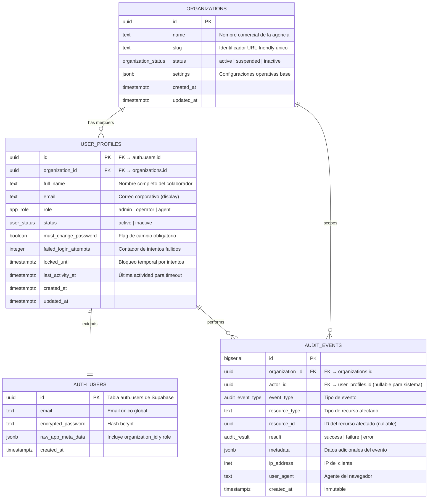
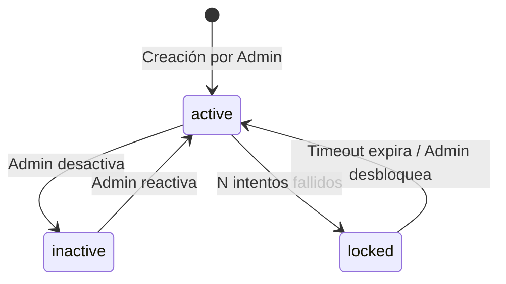

# Data Model: 001-auth-tenant-access

**Date**: 2026-09-08 | **Spec**: [spec.md](./spec.md) | **Research**: [research.md](./research.md)

---

## Entity Relationship Diagram



---

## Entities Detail

### 1. Organization (Tenant)

**Purpose**: Representa la agencia de turismo. Es la unidad de aislamiento de datos (tenant).

| Field | Type | Nullable | Default | Notes |
|-------|------|----------|---------|-------|
| `id` | `uuid` | NO | `gen_random_uuid()` | Primary Key |
| `name` | `text` | NO | — | Nombre comercial, max 255 chars |
| `slug` | `text` | NO | — | Unique, URL-friendly, lowercase |
| `status` | `organization_status` | NO | `'active'` | Enum: `active`, `suspended`, `inactive` |
| `settings` | `jsonb` | YES | `'{}'` | Configuraciones futuras |
| `created_at` | `timestamptz` | NO | `now()` | Inmutable |
| `updated_at` | `timestamptz` | NO | `now()` | Auto-update via trigger |

**Validation Rules**:
- `name` no puede estar vacío y máximo 255 caracteres.
- `slug` debe ser único globalmente, solo letras minúsculas, números y guiones.
- `status` solo acepta valores del enum.

**Indexes**:
- `PK` en `id`
- `UNIQUE` en `slug`
- `INDEX` en `status` (filtrado por organizaciones activas)

---

### 2. User Profile

**Purpose**: Extiende `auth.users` de Supabase con datos de negocio. Representa a un colaborador interno de la agencia.

| Field | Type | Nullable | Default | Notes |
|-------|------|----------|---------|-------|
| `id` | `uuid` | NO | — | PK, FK → `auth.users.id` |
| `organization_id` | `uuid` | NO | — | FK → `organizations.id` |
| `full_name` | `text` | NO | — | Nombre completo, max 255 chars |
| `email` | `text` | NO | — | Email display (copia de auth.users) |
| `role` | `app_role` | NO | `'agent'` | Enum: `admin`, `operator`, `agent` |
| `status` | `user_status` | NO | `'active'` | Enum: `active`, `inactive` |
| `must_change_password` | `boolean` | NO | `true` | Flag de cambio obligatorio primer login |
| `failed_login_attempts` | `integer` | NO | `0` | Contador de intentos fallidos |
| `locked_until` | `timestamptz` | YES | `NULL` | Timestamp de desbloqueo |
| `last_activity_at` | `timestamptz` | YES | `NULL` | Última actividad para timeout |
| `created_at` | `timestamptz` | NO | `now()` | Inmutable |
| `updated_at` | `timestamptz` | NO | `now()` | Auto-update via trigger |

**Validation Rules**:
- `id` debe existir en `auth.users`.
- `organization_id` debe existir en `organizations`.
- `email` unique dentro de la tabla (refleja auth.users).
- `role` solo acepta valores del enum `app_role`.
- `status` solo acepta valores del enum `user_status`.
- `failed_login_attempts` >= 0.

**Indexes**:
- `PK` en `id`
- `INDEX` en `organization_id` (filtrado por tenant, crucial para RLS)
- `UNIQUE` en `email`
- `INDEX` en `(organization_id, status)` (listado de usuarios activos por org)

**State Transitions**:


---

### 3. Audit Event

**Purpose**: Registro inmutable de eventos de seguridad y control de acceso.

| Field | Type | Nullable | Default | Notes |
|-------|------|----------|---------|-------|
| `id` | `bigserial` | NO | auto | PK |
| `organization_id` | `uuid` | NO | — | FK → `organizations.id` |
| `actor_id` | `uuid` | YES | — | FK → `user_profiles.id`, null para eventos de sistema |
| `event_type` | `audit_event_type` | NO | — | Enum de tipos de evento |
| `resource_type` | `text` | YES | — | e.g. `'user_profile'`, `'organization'` |
| `resource_id` | `uuid` | YES | — | ID del recurso afectado |
| `result` | `audit_result` | NO | — | Enum: `success`, `failure`, `error` |
| `metadata` | `jsonb` | YES | `'{}'` | Datos adicionales contextuales |
| `ip_address` | `inet` | YES | — | IP del cliente |
| `user_agent` | `text` | YES | — | User-Agent del navegador |
| `created_at` | `timestamptz` | NO | `now()` | Inmutable |

**Event Types (Enum `audit_event_type`)**:
- `login_success`
- `login_failure`
- `logout`
- `session_expired`
- `user_created`
- `user_updated`
- `user_activated`
- `user_deactivated`
- `role_changed`
- `password_changed`
- `password_reset_forced`
- `organization_created`
- `account_locked`
- `account_unlocked`

**Immutability**:
- Trigger `BEFORE UPDATE OR DELETE` que lanza `RAISE EXCEPTION`.
- No se exponen operaciones de UPDATE/DELETE a nivel de API.
- RLS permite solo SELECT (lectura) para usuarios admin e INSERT para funciones de sistema.

**Indexes**:
- `PK` en `id`
- `BRIN INDEX` en `created_at` (consultas temporales eficientes)
- `INDEX` en `organization_id` (filtrado por tenant)
- `INDEX` en `(organization_id, event_type)` (filtrado por tipo de evento)
- `INDEX` en `actor_id` (búsqueda por usuario)

---

## Enums

```sql
-- Roles de la aplicación
CREATE TYPE public.app_role AS ENUM ('admin', 'operator', 'agent');

-- Estado de la organización
CREATE TYPE public.organization_status AS ENUM ('active', 'suspended', 'inactive');

-- Estado del usuario
CREATE TYPE public.user_status AS ENUM ('active', 'inactive');

-- Tipos de evento de auditoría
CREATE TYPE audit.audit_event_type AS ENUM (
  'login_success', 'login_failure', 'logout', 'session_expired',
  'user_created', 'user_updated', 'user_activated', 'user_deactivated',
  'role_changed', 'password_changed', 'password_reset_forced',
  'organization_created', 'account_locked', 'account_unlocked'
);

-- Resultado de auditoría
CREATE TYPE audit.audit_result AS ENUM ('success', 'failure', 'error');
```

---

## RLS Policies Overview

> **Claim de rol**: el rol de aplicación viaja en el claim `app_role`, **no** en `role`.
> `role` está reservado por Supabase: PostgREST lo interpreta como el rol de PostgreSQL de la
> petición (`SET ROLE`). Ver [ADR-0002](../../docs/adr/0002-jwt-app-role-claim.md).

### organizations

| Policy | Operation | Rule |
|--------|-----------|------|
| `tenant_isolation_select` | SELECT | `id = (auth.jwt() ->> 'organization_id')::uuid` |
| `tenant_isolation_update` | UPDATE | `id = (auth.jwt() ->> 'organization_id')::uuid AND (auth.jwt() ->> 'app_role') = 'admin'` |

### user_profiles

| Policy | Operation | Rule |
|--------|-----------|------|
| `tenant_isolation_select` | SELECT | `organization_id = (auth.jwt() ->> 'organization_id')::uuid` |
| `admin_insert` | INSERT | `(auth.jwt() ->> 'app_role') = 'admin' AND organization_id = (auth.jwt() ->> 'organization_id')::uuid` |
| `admin_update` | UPDATE | `(auth.jwt() ->> 'app_role') = 'admin' AND organization_id = (auth.jwt() ->> 'organization_id')::uuid` |
| `self_update` | UPDATE | `id = auth.uid()` (solo campo permitido: `last_activity_at`) |

> **Alcance de columnas en `self_update`**: RLS no puede restringir columnas. La lista blanca
> (`last_activity_at`) la impone el trigger `enforce_user_profile_update_scope`
> (migración 007, actualizado en la migración 008). Sin él, cualquier colaborador podría
> asignarse el rol `admin`.
>
> **`must_change_password`**: no es auto-escribible. El riesgo residual que documentaba la
> etapa fundacional —un colaborador limpiando el flag sin rotar la contraseña temporal— quedó
> cerrado en la migración 008: la columna salió de la lista blanca y el flag solo puede
> limpiarse a través de `public.change_password` (`SECURITY DEFINER`), que exige la contraseña
> actual y rota la credencial en la misma transacción. Ver
> [ADR-0003](../../docs/adr/0003-server-side-credential-and-lockout-enforcement.md).

### audit.audit_events

| Policy | Operation | Rule |
|--------|-----------|------|
| `admin_select` | SELECT | `organization_id = (auth.jwt() ->> 'organization_id')::uuid AND (auth.jwt() ->> 'app_role') = 'admin'` |
| `system_insert` | INSERT | Solo vía triggers/funciones con `SECURITY DEFINER` |

> Además de RLS, `authenticated` solo tiene privilegio `SELECT` sobre `audit.audit_events`, y
> `service_role` solo `SELECT` e `INSERT`. Ningún rol de aplicación puede ejecutar `UPDATE`,
> `DELETE` ni `TRUNCATE`.

---

## Auth Hook: Custom JWT Claims

> El rol se inyecta en `app_role`. El claim reservado `role` conserva el valor emitido por
> Supabase Auth (`authenticated`). Ver [ADR-0002](../../docs/adr/0002-jwt-app-role-claim.md).

```sql
-- Supabase Auth Hook: Customize Access Token
CREATE OR REPLACE FUNCTION public.custom_access_token_hook(event jsonb)
RETURNS jsonb AS $$
DECLARE
  claims jsonb;
  user_org_id uuid;
  user_role text;
BEGIN
  SELECT organization_id, role::text
  INTO user_org_id, user_role
  FROM public.user_profiles
  WHERE id = (event->>'user_id')::uuid
    AND status = 'active';

  claims := event->'claims';

  IF user_org_id IS NOT NULL THEN
    claims := jsonb_set(claims, '{organization_id}', to_jsonb(user_org_id::text));
    claims := jsonb_set(claims, '{app_role}', to_jsonb(user_role));
  END IF;

  event := jsonb_set(event, '{claims}', claims);
  RETURN event;
END;
$$ LANGUAGE plpgsql STABLE SECURITY DEFINER SET search_path = '';
```

`SET search_path = ''` es obligatorio en funciones `SECURITY DEFINER`: impide que un
`search_path` manipulado redirija `public.user_profiles` a un objeto del atacante. Todas las
referencias del cuerpo están calificadas por esquema.

Un usuario desactivado (`status <> 'active'`) recibe un token **sin** `organization_id` ni
`app_role`. Ese token no satisface ninguna política RLS, por lo que la desactivación surte
efecto en la siguiente emisión de token sin necesidad de revocación explícita.

**Permisos**: `GRANT EXECUTE ... TO supabase_auth_admin` y
`REVOKE EXECUTE ... FROM authenticated, anon, PUBLIC`.

---

## Auth Hook: Password Verification Attempt

Supabase Auth invoca `public.password_verification_hook(event jsonb)` después de comparar la
contraseña contra el hash almacenado, con `{"user_id": uuid, "valid": boolean}`, y respeta la
decisión devuelta (`continue` | `reject`).

Es el único componente que hace avanzar `failed_login_attempts` y `locked_until`: se ejecuta
como `supabase_auth_admin` dentro del flujo de autenticación, de modo que el contador solo
puede moverse ante un intento real y el navegador no lo alcanza.

- 5 verificaciones fallidas consecutivas → `locked_until = now() + 15 minutes`.
- Un bloqueo vigente rechaza el acceso incluso con la contraseña correcta.
- Una cuenta desactivada se rechaza solo después de probar la contraseña.
- Emite `login_success` y `login_failure`; `account_locked` y `account_unlocked` los emite el
  trigger de `locked_until` (migración 007).

**Permisos**: `GRANT EXECUTE ... TO supabase_auth_admin` y
`REVOKE EXECUTE ... FROM authenticated, anon, PUBLIC`.

**Configuración obligatoria**: habilitar *Authentication → Hooks → Password Verification
Attempt* en el proyecto Supabase. Sin ello no hay bloqueo por cuenta.

Ver [ADR-0003](../../docs/adr/0003-server-side-credential-and-lockout-enforcement.md).

---

## Database Functions

### Cambio de Contraseña

`public.change_password(p_current_password text, p_new_password text)` (`SECURITY DEFINER`)
verifica la contraseña actual, la reemplaza en `auth.users.encrypted_password` con bcrypt,
limpia `must_change_password` y elimina las demás sesiones del usuario, todo en una sola
transacción. Es la única vía por la que el flag puede pasar a `false` sin intervención de un
administrador.

Rechaza: contraseña actual incorrecta (`INVALID_CURRENT_PASSWORD`), nueva contraseña de menos
de 8 caracteres o más de 72 bytes (`WEAK_PASSWORD`) y reutilización de la contraseña actual
(`PASSWORD_UNCHANGED`).

### Registro Atómico de Agencia

```sql
-- Función RPC para registro público de agencia.
-- Recibe el user_id ya creado en auth.users (vía Supabase Admin API en la Edge Function).
-- Inserta atómicamente la organización y el perfil admin; si algo falla, la transacción
-- hace rollback completo. Solo `service_role` puede ejecutarla (la Edge Function).
-- Un slug que ya exista se rechaza con AGENCY_SLUG_EXISTS; un email ya perfilado, con
-- EMAIL_ALREADY_EXISTS. El fundador queda con must_change_password = false.
CREATE OR REPLACE FUNCTION public.register_agency(
  p_agency_name text,
  p_admin_user_id uuid,   -- user_id ya creado por la Edge Function vía Admin API
  p_full_name text,
  p_email text
) RETURNS jsonb AS $$
DECLARE
  v_org_id uuid;
  v_slug text;
BEGIN
  -- Generar slug
  v_slug := lower(regexp_replace(p_agency_name, '[^a-zA-Z0-9]+', '-', 'g'));

  -- Crear organización
  INSERT INTO public.organizations (name, slug, status)
  VALUES (p_agency_name, v_slug, 'active')
  RETURNING id INTO v_org_id;

  -- Crear perfil admin (must_change_password=false para el fundador)
  INSERT INTO public.user_profiles (id, organization_id, full_name, email, role, status, must_change_password)
  VALUES (p_admin_user_id, v_org_id, p_full_name, p_email, 'admin', 'active', false);

  RETURN jsonb_build_object(
    'organization_id', v_org_id,
    'user_id', p_admin_user_id
  );
END;
$$ LANGUAGE plpgsql SECURITY DEFINER;
```

**Nota**: La creación atómica completa (auth.users + organization + profile) se implementará como una **Supabase Edge Function** que coordina: (1) Crear usuario via Supabase Admin API, (2) Insertar organización, (3) Insertar perfil. Todo dentro de una transacción lógica.
