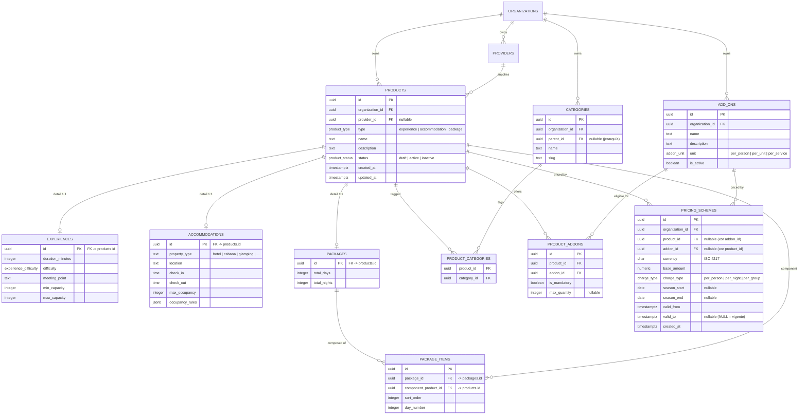
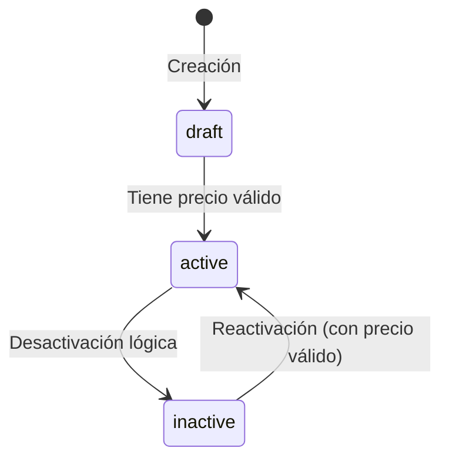

# Data Model: 002-catalog-pricing

**Date**: 2026-09-09 | **Spec**: [spec.md](./spec.md) | **Research**: [research.md](./research.md)

Extiende el esquema de la feature `001-auth-tenant-access` (reutiliza `public.organizations`, `public.user_profiles`, los claims JWT `organization_id`/`app_role`, y `audit.audit_events`).

---

## Entity Relationship Diagram



---

## Entities Detail

### 1. Product (base)

**Purpose**: Entidad base del catálogo. Unidad comercial mínima que puede categorizarse, tener add-ons y precios.

| Field | Type | Nullable | Default | Notes |
|-------|------|----------|---------|-------|
| `id` | `uuid` | NO | `gen_random_uuid()` | PK |
| `organization_id` | `uuid` | NO | — | FK → `organizations.id` (tenant) |
| `provider_id` | `uuid` | YES | `NULL` | FK → `providers.id` |
| `type` | `product_type` | NO | — | `experience`, `accommodation`, `package` |
| `name` | `text` | NO | — | max 255, no vacío |
| `description` | `text` | YES | — | |
| `status` | `product_status` | NO | `'draft'` | `draft`, `active`, `inactive` |
| `created_at` | `timestamptz` | NO | `now()` | Inmutable |
| `updated_at` | `timestamptz` | NO | `now()` | Auto-update via trigger |

**Validation Rules**:
- `name` no vacío, max 255.
- Transición a `active` requiere ≥1 `pricing_scheme` vigente (R-008, trigger).
- `type` inmutable tras creación (una experiencia no se convierte en alojamiento).

**Indexes**: PK; `INDEX (organization_id, status)`; `INDEX (organization_id, type)`.

**State Transitions**:


---

### 2. Experience (subtipo 1:1)

| Field | Type | Nullable | Notes |
|-------|------|----------|-------|
| `id` | `uuid` | NO | PK, FK → `products.id` (ON DELETE CASCADE) |
| `duration_minutes` | `integer` | NO | > 0 |
| `difficulty` | `experience_difficulty` | YES | `easy`, `moderate`, `hard` |
| `meeting_point` | `text` | YES | Punto de encuentro |
| `min_capacity` | `integer` | NO | ≥ 1 |
| `max_capacity` | `integer` | NO | ≥ `min_capacity` |

---

### 3. Accommodation (subtipo 1:1)

| Field | Type | Nullable | Notes |
|-------|------|----------|-------|
| `id` | `uuid` | NO | PK, FK → `products.id` (ON DELETE CASCADE) |
| `property_type` | `text` | NO | hotel, cabaña, glamping, etc. |
| `location` | `text` | NO | Ubicación |
| `check_in` | `time` | YES | Horario check-in |
| `check_out` | `time` | YES | Horario check-out |
| `max_occupancy` | `integer` | NO | ≥ 1 |
| `occupancy_rules` | `jsonb` | YES | Reglas de ocupación |

---

### 4. Package (subtipo 1:1) + Package Items

**packages**

| Field | Type | Nullable | Notes |
|-------|------|----------|-------|
| `id` | `uuid` | NO | PK, FK → `products.id` (ON DELETE CASCADE) |
| `total_days` | `integer` | YES | Días de itinerario |
| `total_nights` | `integer` | YES | Noches de itinerario |

> **Precio de paquete**: el paquete se tarifica de forma **explícita** mediante su propio `pricing_scheme` (con `product_id` = id del producto de tipo `package`), independiente de los precios de sus componentes. La suma automática de componentes queda diferida (ver Clarifications del spec).

**package_items**

| Field | Type | Nullable | Notes |
|-------|------|----------|-------|
| `id` | `uuid` | NO | PK |
| `package_id` | `uuid` | NO | FK → `packages.id` (ON DELETE CASCADE) |
| `component_product_id` | `uuid` | NO | FK → `products.id` (RESTRICT) |
| `sort_order` | `integer` | NO | Orden en el itinerario |
| `day_number` | `integer` | YES | Día del itinerario |

**Validation Rules**:
- `component_product_id` no puede ser un producto `type = 'package'` (no paquetes anidados en el MVP).
- Componente y paquete deben pertenecer a la misma organización.

---

### 5. Category + Product Categories

**categories** (organization-scoped, jerárquica opcional)

| Field | Type | Nullable | Notes |
|-------|------|----------|-------|
| `id` | `uuid` | NO | PK |
| `organization_id` | `uuid` | NO | FK → `organizations.id` |
| `parent_id` | `uuid` | YES | FK → `categories.id` |
| `name` | `text` | NO | max 120 |
| `slug` | `text` | NO | unique por organización |

**product_categories** (N:M)

| Field | Type | Notes |
|-------|------|-------|
| `product_id` | `uuid` | FK → `products.id` (ON DELETE CASCADE) |
| `category_id` | `uuid` | FK → `categories.id` (ON DELETE CASCADE) |
| PK compuesta | (`product_id`, `category_id`) | |

---

### 6. Add-on + Product Add-ons

**add_ons** (organization-scoped)

| Field | Type | Nullable | Notes |
|-------|------|----------|-------|
| `id` | `uuid` | NO | PK |
| `organization_id` | `uuid` | NO | FK → `organizations.id` |
| `name` | `text` | NO | max 255 |
| `description` | `text` | YES | |
| `unit` | `addon_unit` | NO | `per_person`, `per_unit`, `per_service` |
| `is_active` | `boolean` | NO | default `true` |

**product_addons** (elegibilidad + reglas)

| Field | Type | Nullable | Notes |
|-------|------|----------|-------|
| `id` | `uuid` | NO | PK |
| `product_id` | `uuid` | NO | FK → `products.id` (ON DELETE CASCADE) |
| `addon_id` | `uuid` | NO | FK → `add_ons.id` (ON DELETE CASCADE) |
| `is_mandatory` | `boolean` | NO | default `false` |
| `max_quantity` | `integer` | YES | Límite de capacidad del complemento |
| UNIQUE | (`product_id`, `addon_id`) | | |

---

### 7. Pricing Scheme (versionado)

**Purpose**: Esquema tarifario de un producto **o** un add-on. Versionado por `valid_from`/`valid_to` para no-retroactividad (R-003).

| Field | Type | Nullable | Default | Notes |
|-------|------|----------|---------|-------|
| `id` | `uuid` | NO | `gen_random_uuid()` | PK |
| `organization_id` | `uuid` | NO | — | FK → `organizations.id` |
| `product_id` | `uuid` | YES | — | FK → `products.id` (XOR con addon_id) |
| `addon_id` | `uuid` | YES | — | FK → `add_ons.id` (XOR con product_id) |
| `currency` | `char(3)` | NO | (default org) | ISO 4217 |
| `base_amount` | `numeric(12,2)` | NO | — | ≥ 0 |
| `charge_type` | `charge_type` | NO | — | `per_person`, `per_night`, `per_group` |
| `season_start` | `date` | YES | — | Inicio de temporada |
| `season_end` | `date` | YES | — | Fin de temporada |
| `valid_from` | `timestamptz` | NO | `now()` | Inicio de vigencia de la versión |
| `valid_to` | `timestamptz` | YES | `NULL` | `NULL` = versión vigente |
| `created_at` | `timestamptz` | NO | `now()` | Inmutable |

**Validation Rules**:
- Exactamente uno de (`product_id`, `addon_id`) es NO NULL (CHECK XOR).
- Si `season_start`/`season_end` presentes: `season_start <= season_end`.
- `base_amount >= 0`.
- **Anti-solapamiento** (R-004): `EXCLUDE USING gist` sobre (`product_id` =, `charge_type` =, `daterange(season_start, season_end, '[]')` &&) **entre versiones vigentes** (`valid_to IS NULL`).
- Un cambio de tarifa NO hace UPDATE del monto: cierra la versión anterior (`valid_to = now()`) e inserta una nueva (append-only).

**Indexes**: PK; `INDEX (product_id)`; `INDEX (addon_id)`; `INDEX (organization_id)`; GiST para la EXCLUDE constraint.

---

### 8. Provider (metadatos)

| Field | Type | Nullable | Notes |
|-------|------|----------|-------|
| `id` | `uuid` | NO | PK |
| `organization_id` | `uuid` | NO | FK → `organizations.id` |
| `name` | `text` | NO | max 255 |
| `contact_email` | `text` | YES | |
| `contact_phone` | `text` | YES | |
| `metadata` | `jsonb` | YES | Datos operativos |
| `is_active` | `boolean` | NO | default `true` |

---

## Enums

```sql
CREATE TYPE public.product_type AS ENUM ('experience', 'accommodation', 'package');
CREATE TYPE public.product_status AS ENUM ('draft', 'active', 'inactive');
CREATE TYPE public.experience_difficulty AS ENUM ('easy', 'moderate', 'hard');
CREATE TYPE public.addon_unit AS ENUM ('per_person', 'per_unit', 'per_service');
CREATE TYPE public.charge_type AS ENUM ('per_person', 'per_night', 'per_group');
```

---

## RLS Policies Overview

Todas las tablas de catálogo/precio habilitan RLS y filtran por el claim `organization_id` del JWT (patrón heredado de la feature 001). El rol se lee de `auth.jwt() ->> 'app_role'` (ver ADR-0002).

| Tabla | SELECT | INSERT / UPDATE / DELETE (lógico) |
|-------|--------|-----------------------------------|
| `products`, `experiences`, `accommodations`, `packages`, `package_items` | `organization_id = (auth.jwt()->>'organization_id')::uuid` (todos los roles autenticados de la org) | `app_role IN ('operator','admin')` y misma organización |
| `categories`, `product_categories` | misma organización | `operator`/`admin` |
| `add_ons`, `product_addons` | misma organización | `operator`/`admin` |
| `providers` | misma organización | `operator`/`admin` |
| `pricing_schemes` | misma organización | **`operator` y `admin`** para definición/versionado de tarifas; la **sobreescritura manual** de precio se realiza vía RPC `apply_price_override` restringida a **`admin`** |

> Nota: los subtipos y tablas de unión derivan el `organization_id` de su `product`/entidad base; las políticas validan la organización vía join o columna denormalizada `organization_id` (se denormaliza en tablas de subtipo para RLS eficiente).

---

## Triggers & Functions

- `set_updated_at()` — reutiliza el trigger de `updated_at` de la feature 001 (aplicado a `products`, `add_ons`, `providers`, `categories`).
- `enforce_active_requires_price()` — `BEFORE INSERT OR UPDATE` en `products`: bloquea `status = 'active'` si no existe un `pricing_scheme` vigente (R-008).
- `audit_price_override()` — al insertar una nueva versión de `pricing_scheme` que reemplaza a otra, registra en `audit.audit_events` el `event_type = 'price_overridden'` con `metadata` { product_id, previous_amount, new_amount, reason, currency } y el actor (FR: US4 escenario 2).
- `warn_package_inconsistency()` — vista/consulta (o función) que detecta paquetes con componentes `inactive` para advertir en UI (US3 escenario 2). No auto-desactiva.
- `resolve_price(product_id, on_date, charge_type)` — función SQL determinista que devuelve la tarifa vigente para una fecha (aplica temporada si corresponde, si no la base). Base del cálculo testeado en SC-003.

> Nuevo valor de enum de auditoría requerido: agregar `price_overridden` (y opcionalmente `product_activated`/`product_deactivated`) a `audit.audit_event_type` mediante `ALTER TYPE` en una migración de esta feature.
