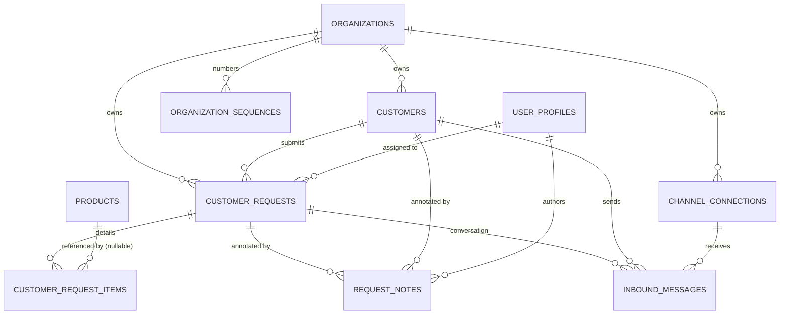
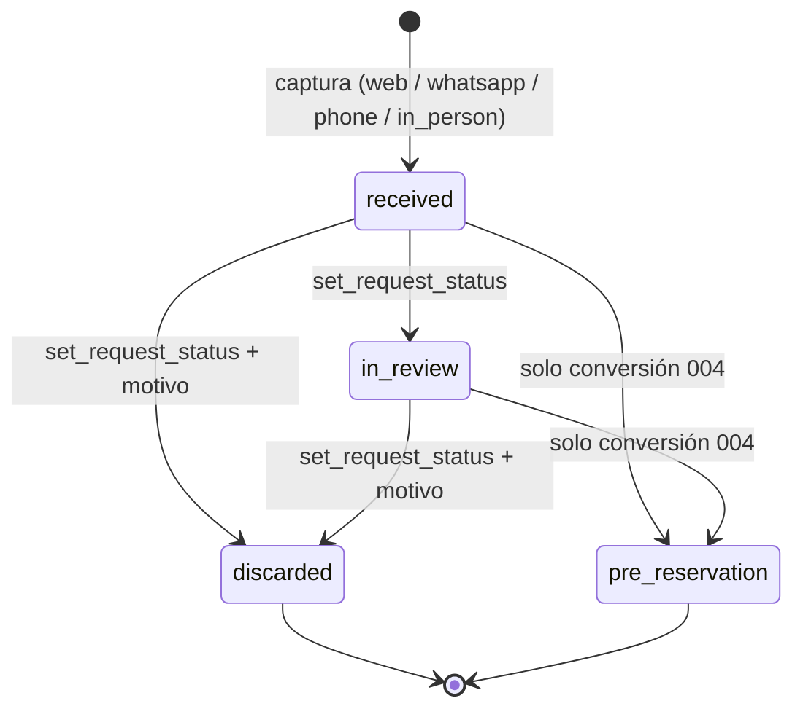

# Data Model: 003-customer-requests-channels

**Date**: 2026-10-04 | **Spec**: [spec.md](./spec.md) | **Research**: [research.md](./research.md)

Extiende el esquema de 001 (`organizations`, `user_profiles`, `audit.audit_events`, `set_updated_at()`, `audit.log_event`), 002 (`products`) y 009 (`public_listings`). Migraciones `028_…` a `034_…`. Convenciones heredadas: FKs compuestas `(x_id, organization_id)` para fijar el tenant, RLS Default Deny, RPCs `SECURITY DEFINER` con `SET search_path = ''` que levantan el código de error del contrato como mensaje (`RAISE EXCEPTION 'CODE' USING ERRCODE = 'raise_exception'`, o `insufficient_privilege` para permisos).

---

## Entity Relationship Diagram



---

## Enums (`028_customer_request_enums.sql`)

```sql
CREATE TYPE public.request_channel AS ENUM ('web', 'whatsapp', 'phone', 'in_person');
CREATE TYPE public.request_status  AS ENUM ('received', 'in_review', 'discarded', 'pre_reservation');
CREATE TYPE public.document_type   AS ENUM ('cc', 'ce', 'passport', 'nit', 'other');

ALTER TYPE audit.audit_event_type ADD VALUE IF NOT EXISTS 'request_received';
ALTER TYPE audit.audit_event_type ADD VALUE IF NOT EXISTS 'request_assigned';
ALTER TYPE audit.audit_event_type ADD VALUE IF NOT EXISTS 'request_status_changed';
ALTER TYPE audit.audit_event_type ADD VALUE IF NOT EXISTS 'customer_updated';
ALTER TYPE audit.audit_event_type ADD VALUE IF NOT EXISTS 'customer_anonymized';
```

Each `ADD VALUE` is its own statement and the new labels are only used from migration `029` onward (same constraint as `012`).

**Etiquetas UI (español)**

| Valor | Etiqueta |
|-------|----------|
| `web` / `whatsapp` / `phone` / `in_person` | Web / WhatsApp / Teléfono / Presencial |
| `received` / `in_review` / `discarded` / `pre_reservation` | Recibida / En gestión / Descartada / En pre-reserva |
| `cc` / `ce` / `passport` / `nit` / `other` | Cédula de ciudadanía / Cédula de extranjería / Pasaporte / NIT / Otro |

---

## 1. Customer — `public.customers` (`029`)

Persona que solicita o adquiere servicios. Única fuente de verdad de la PII del viajero.

| Field | Type | Null | Default | Notes |
|-------|------|------|---------|-------|
| `id` | `uuid` | NO | `gen_random_uuid()` | PK |
| `organization_id` | `uuid` | NO | — | FK → `organizations(id)` `ON DELETE RESTRICT` |
| `first_name` | `text` | NO | — | 1–120, `btrim` |
| `last_name` | `text` | YES | — | ≤ 120 |
| `email` | `text` | YES | — | ya normalizado (`normalize_email`), ≤ 254 |
| `phone_e164` | `text` | YES | — | `^\+[1-9][0-9]{7,14}$` |
| `document_type` | `document_type` | YES | — | |
| `document_number` | `text` | YES | — | ≤ 40; requiere `document_type` |
| `country_code` | `char(2)` | YES | — | ISO 3166-1 alfa-2 mayúsculas |
| `is_anonymized` | `boolean` | NO | `false` | |
| `anonymized_at` | `timestamptz` | YES | — | |
| `created_by` | `uuid` | YES | — | FK → `user_profiles(id)`; NULL para web/WhatsApp |
| `created_at` / `updated_at` | `timestamptz` | NO | `now()` | trigger `set_updated_at()` |

**Constraints**
- `UNIQUE (id, organization_id)` (FKs compuestas de 003/004/005).
- `customers_contact_required CHECK (is_anonymized OR email IS NOT NULL OR phone_e164 IS NOT NULL)`.
- `customers_email_normalized CHECK (email IS NULL OR email = lower(btrim(email)))`.
- `customers_phone_e164_format`, `customers_country_code_format CHECK (country_code ~ '^[A-Z]{2}$')`.
- `customers_document_pair CHECK (document_number IS NULL OR document_type IS NOT NULL)`.
- `customers_anonymized_consistent CHECK (is_anonymized = (anonymized_at IS NOT NULL))`.
- Únicos parciales: `customers_org_email_key (organization_id, email) WHERE email IS NOT NULL`; `customers_org_phone_key (organization_id, phone_e164) WHERE phone_e164 IS NOT NULL`.

**Indexes**: `(organization_id, created_at DESC)`, `(organization_id, lower(first_name), lower(last_name))`.

---

## 2. Customer Request — `public.customer_requests` (`029`)

Intención comercial no vinculante. Nunca bloquea inventario ni crea reservas.

| Field | Type | Null | Default | Notes |
|-------|------|------|---------|-------|
| `id` | `uuid` | NO | `gen_random_uuid()` | PK |
| `organization_id` | `uuid` | NO | — | FK → `organizations` |
| `reference` | `text` | NO | — | `SOL-00001` (R-013) |
| `customer_id` | `uuid` | NO | — | FK `(customer_id, organization_id)` → `customers(id, organization_id)` `ON DELETE RESTRICT` |
| `channel` | `request_channel` | NO | — | inmutable (trigger) |
| `status` | `request_status` | NO | `'received'` | solo por RPC |
| `assigned_to` | `uuid` | YES | — | FK `customer_requests_assigned_to_fkey` `(assigned_to, organization_id)` → `user_profiles(id, organization_id)` (el nombre lo usa el embed de PostgREST) |
| `assigned_at` | `timestamptz` | YES | — | última asignación |
| `travel_start_date` | `date` | YES | — | no pasada al crear (RPC) |
| `travel_end_date` | `date` | YES | — | |
| `adults` | `smallint` | NO | `1` | 1–99 |
| `children` | `smallint` | NO | `0` | 0–99 |
| `special_requirements` | `text` | YES | — | ≤ 2000 |
| `locale` | `text` | YES | — | `'es'` \| `'en'` (web) |
| `source_page` | `text` | YES | — | ruta del sitio que originó la solicitud, ≤ 500 |
| `submitted_contact` | `jsonb` | YES | — | `{first_name,last_name,email,phone_e164,country_code}` tal como se recibió y normalizó, solo si difiere del perfil (R-005) |
| `contact_review_required` | `boolean` | NO | `false` | «Datos de contacto a revisar» |
| `privacy_consent_at` | `timestamptz` | YES | — | obligatorio para `web` y captura asistida |
| `idempotency_key` | `uuid` | YES | — | R-006 |
| `dedup_fingerprint` | `text` | NO | — | md5 (R-006) |
| `discard_reason` | `text` | YES | — | 1–500, obligatorio si `discarded` |
| `first_handled_at` | `timestamptz` | YES | — | primera salida de `received` |
| `closed_at` | `timestamptz` | YES | — | `discarded` o `pre_reservation` |
| `created_by` | `uuid` | YES | — | FK → `user_profiles(id)`; NULL para web/WhatsApp |
| `created_at` / `updated_at` | `timestamptz` | NO | `now()` | trigger `set_updated_at()` |

**Constraints**
- `UNIQUE (id, organization_id)` (FK de 004 y de items/notas/mensajes).
- `UNIQUE (organization_id, reference)`; `UNIQUE (organization_id, idempotency_key) WHERE idempotency_key IS NOT NULL`.
- `customer_requests_date_range CHECK (travel_end_date IS NULL OR travel_start_date IS NULL OR travel_end_date >= travel_start_date)`.
- `customer_requests_locale CHECK (locale IS NULL OR locale IN ('es','en'))`.
- `customer_requests_discard_reason CHECK ((status = 'discarded') = (discard_reason IS NOT NULL))`.
- `customer_requests_closed_at CHECK ((status IN ('discarded','pre_reservation')) = (closed_at IS NOT NULL))`.
- `customer_requests_first_handled CHECK (status = 'received' OR first_handled_at IS NOT NULL)`.
- `customer_requests_web_consent CHECK (channel <> 'web' OR privacy_consent_at IS NOT NULL)`.
- Trigger `prevent_customer_request_channel_change` (BEFORE UPDATE): `channel`, `customer_id`, `reference`, `created_at` inmutables.

**Indexes**: `(organization_id, status, created_at DESC)`, `(organization_id, channel, created_at DESC)`, `(customer_id, created_at DESC)` (historial, FR-007), `(organization_id, assigned_to)`, `(organization_id, dedup_fingerprint, created_at DESC)`.

**State transitions** (R-010)



Asignación (`assign_request`) y notas no cambian el estado. En `discarded` o `pre_reservation` solo se pueden agregar notas (`REQUEST_CLOSED` para asignar o cambiar estado).

---

## 3. Request Item — `public.customer_request_items` (`029`)

| Field | Type | Null | Notes |
|-------|------|------|-------|
| `id` | `uuid` | NO | PK |
| `organization_id` | `uuid` | NO | |
| `request_id` | `uuid` | NO | FK `(request_id, organization_id)` → `customer_requests` `ON DELETE CASCADE` |
| `product_id` | `uuid` | YES | FK `(product_id, organization_id)` → `products(id, organization_id)` `ON DELETE RESTRICT` |
| `public_slug` | `text` | YES | instantánea del slug pedido desde la web |
| `free_text` | `text` | YES | ≤ 500 |
| `quantity` | `smallint` | NO | default `1`, 1–99 |
| `position` | `smallint` | NO | orden de captura, 0-based |

**Constraints**: `CHECK (product_id IS NOT NULL OR free_text IS NOT NULL)`; `UNIQUE (request_id, position)`. Index `(organization_id, product_id)`.

---

## 4. Organization Sequence — `public.organization_sequences` (`029`)

| Field | Type | Notes |
|-------|------|-------|
| `organization_id` | `uuid` | PK parte 1, FK → `organizations` |
| `scope` | `text` | PK parte 2; `'customer_request'` (futuro: `'quotation'`, `'reservation'`) |
| `last_value` | `bigint` | ≥ 0 |

RLS habilitado sin políticas; `REVOKE ALL` a `anon` y `authenticated`. Solo la usa `next_organization_sequence`.

---

## 5. Channel Connection — `public.channel_connections` (`032`)

| Field | Type | Null | Notes |
|-------|------|------|-------|
| `id` | `uuid` | NO | PK |
| `organization_id` | `uuid` | NO | FK → `organizations` |
| `channel` | `request_channel` | NO | `CHECK (channel = 'whatsapp')` en el MVP |
| `provider` | `text` | NO | `CHECK (provider IN ('meta_cloud'))` |
| `external_account_id` | `text` | NO | `phone_number_id` de Meta |
| `display_phone` | `text` | YES | número visible de la agencia |
| `status` | `text` | NO | `'active'` \| `'inactive'`, default `'active'` |
| `created_at` / `updated_at` | `timestamptz` | NO | |

**Constraints**: `UNIQUE (provider, external_account_id)` (resuelve el tenant de un webhook); `UNIQUE (id, organization_id)`. Sin credenciales: los secretos viven en variables de entorno de la Edge Function. Alta/baja por SQL o seed en el MVP.

---

## 6. Inbound Message — `public.inbound_messages` (`032`)

| Field | Type | Null | Notes |
|-------|------|------|-------|
| `id` | `uuid` | NO | PK |
| `organization_id` | `uuid` | NO | |
| `connection_id` | `uuid` | NO | FK `(connection_id, organization_id)` → `channel_connections` |
| `channel` | `request_channel` | NO | `'whatsapp'` |
| `provider` | `text` | NO | copia de la conexión |
| `provider_message_id` | `text` | NO | `messages[].id` (`wamid…`) |
| `from_phone_e164` | `text` | YES | NULL tras anonimizar |
| `profile_name` | `text` | YES | `contacts[].profile.name`, ≤ 120 |
| `message_type` | `text` | NO | `text`, `image`, … |
| `body` | `text` | NO | ≤ 4096; tipos no soportados: `[mensaje no soportado: <tipo>]` |
| `provider_timestamp` | `timestamptz` | NO | `to_timestamp(messages[].timestamp)` |
| `customer_id` | `uuid` | NO | FK compuesta → `customers` |
| `request_id` | `uuid` | NO | FK compuesta → `customer_requests` |
| `received_at` | `timestamptz` | NO | `now()` |

**Constraints**: `UNIQUE (provider, provider_message_id)` (reintentos idempotentes). Index `(request_id, provider_timestamp)`. Append-only salvo la limpieza de `anonymize_customer`.

---

## 7. Follow-up Note — `public.request_notes` (`033`)

| Field | Type | Null | Notes |
|-------|------|------|-------|
| `id` | `uuid` | NO | PK |
| `organization_id` | `uuid` | NO | |
| `request_id` | `uuid` | YES | FK compuesta → `customer_requests` |
| `customer_id` | `uuid` | YES | FK compuesta → `customers` |
| `author_id` | `uuid` | NO | FK `(author_id, organization_id)` → `user_profiles(id, organization_id)` |
| `content` | `text` | NO | 1–4000 |
| `created_at` | `timestamptz` | NO | `now()` |

**Constraints**: `CHECK (num_nonnulls(request_id, customer_id) = 1)`. Trigger `reject_request_note_mutation` (BEFORE UPDATE OR DELETE) → excepción: append-only. Index `(request_id, created_at)`, `(customer_id, created_at)`.

---

## 8. Supporting change — `public.user_profiles` (`029`)

`ALTER TABLE public.user_profiles ADD CONSTRAINT user_profiles_id_organization_id_key UNIQUE (id, organization_id);` — permite FKs compuestas para `assigned_to` y `author_id`. `id` ya es PK, así que no puede fallar con datos existentes.

---

## Views (`029`, `WITH (security_invoker = true)`)

**`public.customer_request_list`** — bandeja de solicitudes.
Columnas: `id, organization_id, reference, channel, status, created_at, travel_start_date, travel_end_date, adults, children, contact_review_required, assigned_to, assignee_name (user_profiles.full_name), customer_id, customer_first_name, customer_last_name, customer_email, customer_phone_e164, customer_is_anonymized, item_count`.

**`public.customer_list`** — listado de clientes.
Columnas: `id, organization_id, first_name, last_name, email, phone_e164, country_code, is_anonymized, created_at, request_count, last_request_at`.

`REVOKE ALL ... FROM anon`; `GRANT SELECT ... TO authenticated`. Las vistas aplican el RLS de las tablas base del usuario que consulta.

---

## RLS & Privileges

| Objeto | `anon` | `authenticated` | Política |
|--------|--------|-----------------|----------|
| `customers`, `customer_requests`, `customer_request_items`, `request_notes`, `inbound_messages`, `channel_connections` | sin privilegios | `SELECT` únicamente (`INSERT/UPDATE/DELETE` revocados) | `tenant_isolation_select`: `organization_id = (auth.jwt() ->> 'organization_id')::uuid` |
| `organization_sequences` | — | — | sin políticas |
| vistas `customer_request_list`, `customer_list` | — | `SELECT` | heredan RLS (`security_invoker`) |

Todos los roles internos (`agent`, `operator`, `admin`) leen la organización completa (bandeja compartida). `service_role` omite RLS y solo se usa desde la Edge Function `whatsapp-inbound`.

**Realtime**: `029` ejecuta `ALTER PUBLICATION supabase_realtime ADD TABLE public.customer_requests` solo si `pg_publication` contiene `supabase_realtime`.

---

## Functions

Todas con `SET search_path = ''`. "Interna" = `REVOKE ALL FROM PUBLIC, anon, authenticated` (solo la llaman otras funciones `SECURITY DEFINER`).

### Núcleo (`030_customer_intake_core.sql`)

| Función | Tipo | Comportamiento |
|---------|------|----------------|
| `normalize_email(p_raw text) → text` | `IMMUTABLE`, interna | NULL si vacío; `lower(btrim())`; formato inválido o > 254 → `INVALID_EMAIL`. |
| `normalize_phone_e164(p_raw text, p_default_country_code text) → text` | `IMMUTABLE`, interna | R-004. NULL si vacío; inválido → `INVALID_PHONE`. |
| `organization_phone_country_code(p_org uuid) → text` | `STABLE`, interna | `settings ->> 'default_phone_country_code'` o `'57'`. |
| `next_organization_sequence(p_org uuid, p_scope text) → bigint` | `VOLATILE`, interna | `INSERT … ON CONFLICT DO UPDATE SET last_value = last_value + 1 RETURNING last_value`. |
| `require_tenant_member() → uuid` | `STABLE`, interna | Como `require_catalog_manager()` pero acepta `agent`, `operator`, `admin` activos; `SESSION_EXPIRED` / `INSUFFICIENT_PERMISSIONS`. |
| `match_or_create_customer(p_org uuid, p_contact jsonb, p_actor uuid) → jsonb` | interna | R-005. Devuelve `{customer_id, customer_created, contact_review_required, submitted_contact}`. Requiere `first_name` y email o teléfono (`CONTACT_REQUIRED`). |
| `capture_request_core(p_org uuid, p_channel request_channel, p_customer_id uuid, p_contact jsonb, p_request jsonb, p_items jsonb, p_actor uuid) → jsonb` | interna | Valida fechas contra `(now() AT TIME ZONE 'America/Bogota')::date` (`TRAVEL_DATE_IN_PAST`, `INVALID_DATE_RANGE`), pasajeros (`VALIDATION_ERROR`); resuelve cliente (`p_customer_id` dado → debe ser de la org y no anonimizado, si no `VALIDATION_ERROR` / `CUSTOMER_ANONYMIZED`; si no, `match_or_create_customer`); dedup (R-006); asigna `reference`; inserta solicitud `received` + ítems ya resueltos (`[{product_id?, public_slug?, free_text?, quantity}]`); emite `request_received`. Devuelve `{request_id, reference, customer_id, customer_created, deduplicated, contact_review_required}`. |

### US1 (`031`)

| `submit_public_request(p_organization_id uuid, p_payload jsonb) → jsonb` | `SECURITY DEFINER`; `GRANT EXECUTE TO anon, authenticated` | R-001/R-002/R-003. Devuelve `{reference, deduplicated}`. |

### US2 (`032`)

| Función | Acceso | Comportamiento |
|---------|--------|----------------|
| `create_assisted_request(p_payload jsonb) → jsonb` | `authenticated` (`require_tenant_member`) | Canal `whatsapp`/`phone`/`in_person` (`web` → `VALIDATION_ERROR`); `customer_id` o `contact`; ítems `product_id` (activo, de la org) o `free_text`; `privacy_notice_given = true` obligatorio (`CONSENT_REQUIRED`); `assigned_to = auth.uid()`, `assigned_at = now()`. |
| `ingest_whatsapp_webhook(p_payload jsonb) → jsonb` | solo `service_role` | R-007. Devuelve `{processed, duplicates, ignored, requests_created, messages_attached}`. |

### US3 (`033`)

| Función | Acceso | Comportamiento |
|---------|--------|----------------|
| `update_customer(p_customer_id uuid, p_payload jsonb) → jsonb` | `authenticated` | Normaliza; anonimizado → `CUSTOMER_ANONYMIZED`; email/teléfono de otro cliente → `CUSTOMER_CONTACT_TAKEN`; sin email ni teléfono → `CONTACT_REQUIRED`; audita `customer_updated` con nombres de campos. |
| `assign_request(p_request_id uuid, p_assignee_id uuid) → jsonb` | `authenticated` | `p_assignee_id` NULL desasigna; colaborador inactivo o de otra org → `ASSIGNEE_NOT_IN_ORGANIZATION`; cerrada → `REQUEST_CLOSED`; audita `request_assigned`. |
| `set_request_status(p_request_id uuid, p_status request_status, p_reason text DEFAULT NULL) → jsonb` | `authenticated` | R-010; audita `request_status_changed`. |
| `add_request_note(p_request_id uuid, p_customer_id uuid, p_content text) → jsonb` | `authenticated` | XOR de destino (`VALIDATION_ERROR`); `author_id = auth.uid()`. |

### US4 (`034`)

| `anonymize_customer(p_customer_id uuid, p_reason text) → jsonb` | `authenticated` (`require_tenant_admin`) | R-012. Ya anonimizado → `CUSTOMER_ANONYMIZED`. |

Solicitud/cliente inexistente o de otra organización → `VALIDATION_ERROR` en todas las RPCs (mismo criterio que 002/009: no revelar existencia).

---

## Cross-feature references

- **001**: `organizations.settings`, `user_profiles`, claims `organization_id`/`app_role`, `audit.log_event`, `set_updated_at()`, `require_tenant_admin()`.
- **002**: `products (id, organization_id)`.
- **009**: `public_listings (organization_id, public_slug, status, sold_out, product_id)`; `get_public_site` expone `id = public_slug` y `acceptsRequests`.
- **004–008**: ver research R-014.
