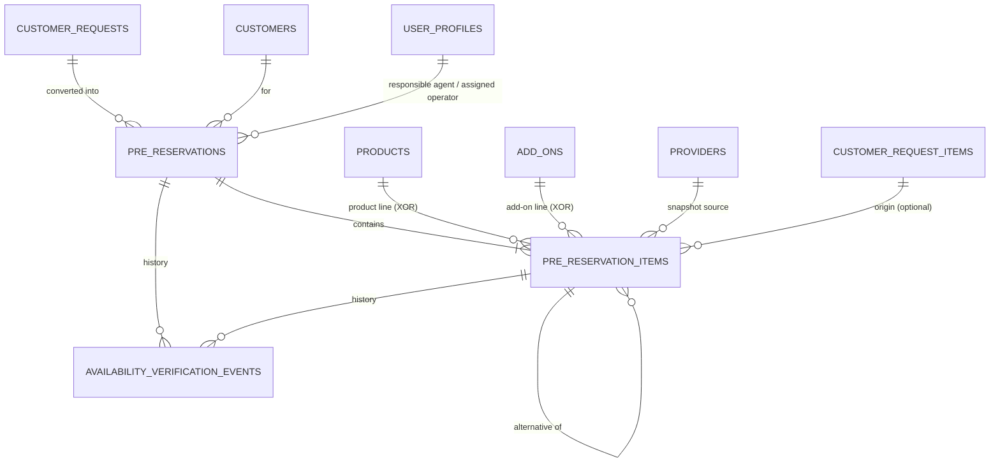
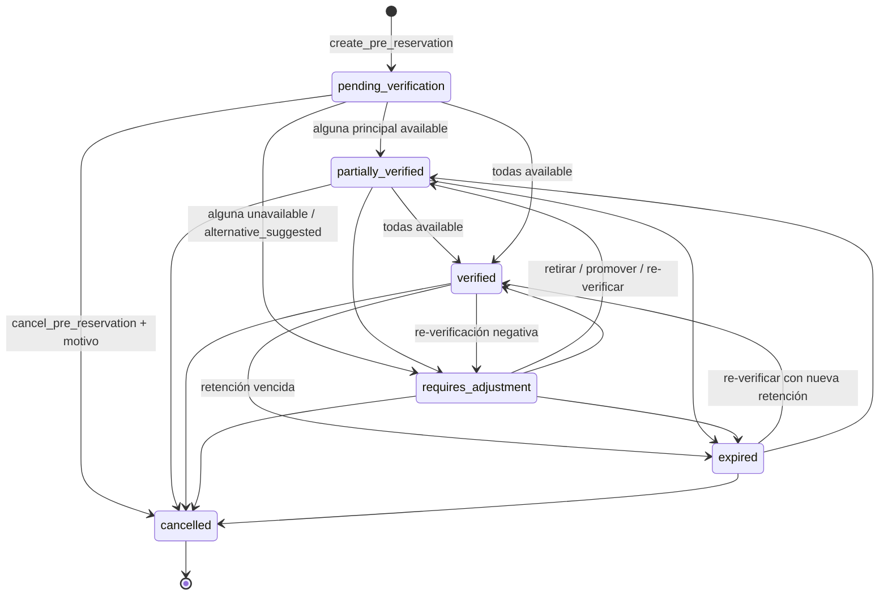

# Data Model: 004-prereservation-availability

**Date**: 2026-10-04 | **Spec**: [spec.md](./spec.md) | **Research**: [research.md](./research.md)

Extiende el esquema de 001 (`organizations`, `user_profiles`, `audit.log_event`, `set_updated_at()`, `require_tenant_admin()`), 002 (`products`, `add_ons`, `providers`, `require_catalog_manager()`) y 003 (`customers`, `customer_requests`, `customer_request_items`, `organization_sequences`, `next_organization_sequence()`, `require_tenant_member()`). Migraciones `035_…` a `041_…`.

Convenciones heredadas, todas obligatorias:

- FKs compuestas `(x_id, organization_id)` para fijar el tenant.
- RLS Default Deny de solo `SELECT`.
- RPCs `SECURITY DEFINER` con `SET search_path = ''` que levantan el código del contrato como mensaje: `RAISE EXCEPTION 'CODE' USING ERRCODE = 'raise_exception'`, o `insufficient_privilege` para permisos.
- Una fila inexistente o de otra organización devuelve `VALIDATION_ERROR`, para no revelar su existencia.
- «Hoy» es `(now() AT TIME ZONE 'America/Bogota')::date`.

---

## Entity Relationship Diagram



---

## Enums (`035_pre_reservation_enums.sql`)

```sql
CREATE TYPE public.pre_reservation_status AS ENUM (
  'pending_verification', 'partially_verified', 'verified',
  'requires_adjustment', 'expired', 'cancelled'
);
CREATE TYPE public.availability_status AS ENUM (
  'pending', 'available', 'unavailable', 'alternative_suggested'
);
CREATE TYPE public.provider_contact_method AS ENUM ('phone', 'whatsapp', 'email', 'other');
CREATE TYPE public.availability_event_kind AS ENUM (
  'item_added', 'verification_started', 'outcome_recorded', 'item_withdrawn',
  'alternative_promoted', 'pre_reservation_cancelled', 'quote_override_authorized'
);

ALTER TYPE audit.audit_event_type ADD VALUE IF NOT EXISTS 'pre_reservation_created';
ALTER TYPE audit.audit_event_type ADD VALUE IF NOT EXISTS 'pre_reservation_status_changed';
ALTER TYPE audit.audit_event_type ADD VALUE IF NOT EXISTS 'pre_reservation_items_changed';
ALTER TYPE audit.audit_event_type ADD VALUE IF NOT EXISTS 'pre_reservation_assigned';
ALTER TYPE audit.audit_event_type ADD VALUE IF NOT EXISTS 'availability_recorded';
ALTER TYPE audit.audit_event_type ADD VALUE IF NOT EXISTS 'pre_reservation_cancelled';
ALTER TYPE audit.audit_event_type ADD VALUE IF NOT EXISTS 'quotation_override_authorized';
```

Cada `ADD VALUE` es una sentencia aparte. Los valores nuevos se usan recién desde `036`, la misma restricción que tienen `012` y `028`.

**Etiquetas UI (español)**

| Enum | Valor → Etiqueta |
|------|------------------|
| `pre_reservation_status` | `pending_verification` Pendiente de verificación · `partially_verified` Parcialmente verificada · `verified` Totalmente verificada · `requires_adjustment` Requiere ajuste · `expired` Expirada · `cancelled` Cancelada |
| `availability_status` | `pending` Pendiente · `available` Disponible · `unavailable` No disponible · `alternative_suggested` Alternativa sugerida |
| `provider_contact_method` | `phone` Llamada · `whatsapp` WhatsApp · `email` Correo · `other` Otro |
| `availability_event_kind` | `item_added` Servicio agregado · `verification_started` Gestión iniciada · `outcome_recorded` Resultado registrado · `item_withdrawn` Servicio retirado · `alternative_promoted` Alternativa promovida · `pre_reservation_cancelled` Pre-reserva cancelada · `quote_override_authorized` Excepción para cotizar autorizada |
| `item_kind` (text) | `experience` Experiencia · `accommodation` Alojamiento · `package` Paquete · `addon` Complemento |

---

## 0. Supporting change — `public.providers` (`036`)

`ALTER TABLE public.providers ADD CONSTRAINT providers_id_organization_id_key UNIQUE (id, organization_id);` permite la FK compuesta de la línea. No puede fallar con los datos existentes porque `id` ya es PK.

---

## 1. Pre-Reservation — `public.pre_reservations` (`036`)

Agrupación operativa de servicios a verificar. **No es una reserva** y no bloquea inventario.

| Field | Type | Null | Default | Notes |
|-------|------|------|---------|-------|
| `id` | `uuid` | NO | `gen_random_uuid()` | PK |
| `organization_id` | `uuid` | NO | — | FK → `organizations(id)` `ON DELETE RESTRICT` |
| `reference` | `text` | NO | — | `PRE-00001` (R-012) |
| `request_id` | `uuid` | NO | — | FK `pre_reservations_request_fkey` `(request_id, organization_id)` → `customer_requests(id, organization_id)` `RESTRICT` |
| `customer_id` | `uuid` | NO | — | FK `pre_reservations_customer_fkey` `(customer_id, organization_id)` → `customers`; copiado de la solicitud |
| `responsible_agent_id` | `uuid` | NO | — | FK `pre_reservations_responsible_agent_fkey` `(responsible_agent_id, organization_id)` → `user_profiles(id, organization_id)`; el creador |
| `assigned_operator_id` | `uuid` | YES | — | FK `pre_reservations_assigned_operator_fkey` → `user_profiles(id, organization_id)`; operador/admin activo |
| `status` | `pre_reservation_status` | NO | `'pending_verification'` | solo vía `refresh_pre_reservation_status` / `cancel_pre_reservation` |
| `expires_at` | `timestamptz` | YES | — | derivada: `min(hold_expires_at)` de principales `available` |
| `verified_at` | `timestamptz` | YES | — | `= now()` al entrar en `verified`; NULL fuera de `verified` |
| `first_verified_at` | `timestamptz` | YES | — | primera vez en `verified`; nunca se limpia (SC-002) |
| `cancelled_at` | `timestamptz` | YES | — | |
| `cancel_reason` | `text` | YES | — | 1–500 |
| `cancelled_by` | `uuid` | YES | — | FK `(cancelled_by, organization_id)` → `user_profiles` |
| `quote_override_at` | `timestamptz` | YES | — | excepción de admin (R-008) |
| `quote_override_by` | `uuid` | YES | — | FK `(quote_override_by, organization_id)` → `user_profiles` |
| `quote_override_reason` | `text` | YES | — | 1–500 |
| `created_by` | `uuid` | YES | — | FK → `user_profiles(id)` `ON DELETE SET NULL` |
| `created_at` / `updated_at` | `timestamptz` | NO | `now()` | trigger `set_updated_at()` |

**Constraints**
- `pre_reservations_id_organization_id_key UNIQUE (id, organization_id)`; `pre_reservations_reference_key UNIQUE (organization_id, reference)`.
- `pre_reservations_cancel_consistent CHECK ((status = 'cancelled') = (cancelled_at IS NOT NULL) AND (cancelled_at IS NULL) = (cancel_reason IS NULL))`.
- `pre_reservations_cancel_reason_len CHECK (cancel_reason IS NULL OR char_length(btrim(cancel_reason)) BETWEEN 1 AND 500)`.
- `pre_reservations_verified_consistent CHECK ((status = 'verified') = (verified_at IS NOT NULL))`.
- `pre_reservations_first_verified CHECK (verified_at IS NULL OR first_verified_at IS NOT NULL)`.
- `pre_reservations_override_all_or_none CHECK (num_nulls(quote_override_at, quote_override_by, quote_override_reason) IN (0, 3))`.
- `pre_reservations_override_reason_len CHECK (quote_override_reason IS NULL OR char_length(btrim(quote_override_reason)) BETWEEN 1 AND 500)`.
- Trigger `pre_reservations_prevent_identity_change` (BEFORE UPDATE): `request_id`, `customer_id`, `reference`, `responsible_agent_id`, `created_at` inmutables → `VALIDATION_ERROR`.

**Indexes**: `(organization_id, status, created_at DESC)`, `(request_id, created_at)`, `(organization_id, responsible_agent_id, created_at DESC)`, `(organization_id, assigned_operator_id)`.

**State transitions** (R-003)



Todas las transiciones salvo `cancelled` son **derivadas**: no existe un «set status» manual. `verified` dispara el aviso al agente responsable (R-011).

---

## 2. Pre-Reservation Item — `public.pre_reservation_items` (`036`)

| Field | Type | Null | Default | Notes |
|-------|------|------|---------|-------|
| `id` | `uuid` | NO | `gen_random_uuid()` | PK |
| `organization_id` | `uuid` | NO | — | |
| `pre_reservation_id` | `uuid` | NO | — | FK `(pre_reservation_id, organization_id)` → `pre_reservations` `RESTRICT` |
| `position` | `smallint` | NO | — | 0-based, orden de alta |
| `alternative_of_item_id` | `uuid` | YES | — | FK `(alternative_of_item_id, organization_id)` → `pre_reservation_items(id, organization_id)`; NULL = principal |
| `item_kind` | `text` | NO | — | `experience` \| `accommodation` \| `package` \| `addon` |
| `product_id` | `uuid` | YES | — | FK `(product_id, organization_id)` → `products` `RESTRICT` |
| `addon_id` | `uuid` | YES | — | FK `(addon_id, organization_id)` → `add_ons(id, organization_id)` `RESTRICT` |
| `source_request_item_id` | `uuid` | YES | — | FK → `customer_request_items(id)` `ON DELETE SET NULL`; la RPC exige que pertenezca a la solicitud origen |
| `item_label` | `text` | NO | — | instantánea de `products.name` / `add_ons.name`, ≤ 255 |
| `start_date` | `date` | NO | — | ≥ hoy (RPC) |
| `end_date` | `date` | YES | — | ≥ `start_date`; obligatorio y > `start_date` si `accommodation` |
| `adults` | `smallint` | NO | `1` | 1–99 |
| `children` | `smallint` | NO | `0` | 0–99 |
| `quantity` | `smallint` | NO | `1` | 1–99 (habitaciones, unidades, servicios) |
| `provider_id` | `uuid` | YES | — | FK `(provider_id, organization_id)` → `providers(id, organization_id)` |
| `provider_name` | `text` | YES | — | instantánea o manual, ≤ 255 |
| `provider_phone` | `text` | YES | — | instantánea o manual, ≤ 40 |
| `provider_email` | `text` | YES | — | instantánea o manual, ≤ 254 |
| `verification_status` | `availability_status` | NO | `'pending'` | |
| `verification_started_at` | `timestamptz` | YES | — | primer «Iniciar gestión» o primer resultado |
| `verified_by` | `uuid` | YES | — | FK `pre_reservation_items_verified_by_fkey` `(verified_by, organization_id)` → `user_profiles` |
| `verified_at` | `timestamptz` | YES | — | último resultado |
| `provider_contact_person` | `text` | YES | — | con quién habló el operador, 1–120 |
| `contact_method` | `provider_contact_method` | YES | — | |
| `hold_expires_at` | `timestamptz` | YES | — | retención del proveedor; solo con `available` |
| `alternative_suggestion` | `text` | YES | — | ≤ 1000; obligatorio con `alternative_suggested` |
| `operator_notes` | `text` | YES | — | ≤ 2000 |
| `withdrawn_at` | `timestamptz` | YES | — | retiro lógico |
| `withdrawn_reason` | `text` | YES | — | 1–500 |
| `withdrawn_by` | `uuid` | YES | — | FK `(withdrawn_by, organization_id)` → `user_profiles` |
| `created_by` | `uuid` | YES | — | FK → `user_profiles(id)` `ON DELETE SET NULL` |
| `created_at` / `updated_at` | `timestamptz` | NO | `now()` | trigger `set_updated_at()` |

**Constraints**
- `pre_reservation_items_id_organization_id_key UNIQUE (id, organization_id)`; `pre_reservation_items_position_key UNIQUE (pre_reservation_id, position)`.
- `pre_reservation_items_target CHECK (num_nonnulls(product_id, addon_id) = 1)`.
- `pre_reservation_items_kind CHECK (item_kind IN ('experience','accommodation','package','addon') AND (item_kind = 'addon') = (addon_id IS NOT NULL))`.
- `pre_reservation_items_date_range CHECK (end_date IS NULL OR end_date >= start_date)`.
- `pre_reservation_items_nights CHECK (item_kind <> 'accommodation' OR (end_date IS NOT NULL AND end_date > start_date))`.
- `pre_reservation_items_pax CHECK (adults BETWEEN 1 AND 99 AND children BETWEEN 0 AND 99 AND quantity BETWEEN 1 AND 99)`.
- `pre_reservation_items_not_self_alternative CHECK (alternative_of_item_id IS NULL OR alternative_of_item_id <> id)`.
- `pre_reservation_items_outcome_complete CHECK (verification_status = 'pending' OR (verified_at IS NOT NULL AND verified_by IS NOT NULL AND provider_contact_person IS NOT NULL AND contact_method IS NOT NULL))`.
- `pre_reservation_items_hold_only_available CHECK (hold_expires_at IS NULL OR verification_status = 'available')`.
- `pre_reservation_items_alternative_text CHECK (verification_status <> 'alternative_suggested' OR alternative_suggestion IS NOT NULL)`.
- `pre_reservation_items_withdrawn_consistent CHECK (num_nulls(withdrawn_at, withdrawn_reason, withdrawn_by) IN (0, 3))`.
- Límites de longitud de texto según la tabla anterior.
- Trigger `pre_reservation_items_prevent_identity_change` (BEFORE UPDATE): `pre_reservation_id`, `position`, `item_kind`, `product_id`, `addon_id`, `start_date`, `end_date`, `adults`, `children`, `quantity`, `created_at` inmutables → `VALIDATION_ERROR` (R-005). `alternative_of_item_id` solo puede pasar a NULL o a otra principal de la misma pre-reserva; esa regla la valida la RPC de promoción.

**Indexes**: `(organization_id, verification_status, start_date) WHERE withdrawn_at IS NULL`, `(organization_id, provider_id, start_date) WHERE withdrawn_at IS NULL`, `(organization_id, hold_expires_at) WHERE verification_status = 'available' AND withdrawn_at IS NULL`, `(alternative_of_item_id)`.

**Reglas de negocio** (RPCs; R-005)
- Una alternativa cuelga de una principal de la **misma** pre-reserva, y esa principal no puede ser a su vez una alternativa (`VALIDATION_ERROR`).
- Una pre-reserva no cancelada conserva al menos una principal vigente (`PRE_RESERVATION_REQUIRES_ITEMS`).
- Máximo 30 líneas, contando las retiradas (`VALIDATION_ERROR`).
- Una línea retirada no admite más cambios (`ITEM_WITHDRAWN`).

---

## 3. Verification Event — `public.availability_verification_events` (`036`)

Historial append-only (R-007). Contiene datos de contacto del **proveedor**, nunca PII del viajero.

| Field | Type | Null | Notes |
|-------|------|------|-------|
| `id` | `bigint` | NO | `GENERATED ALWAYS AS IDENTITY` PK |
| `organization_id` | `uuid` | NO | |
| `pre_reservation_id` | `uuid` | NO | FK compuesta → `pre_reservations` |
| `item_id` | `uuid` | YES | FK compuesta → `pre_reservation_items`; NULL solo para `pre_reservation_cancelled`, `quote_override_authorized` |
| `event_kind` | `availability_event_kind` | NO | |
| `from_status` | `availability_status` | YES | |
| `to_status` | `availability_status` | YES | |
| `provider_contact_person` | `text` | YES | ≤ 120 |
| `contact_method` | `provider_contact_method` | YES | |
| `hold_expires_at` | `timestamptz` | YES | |
| `notes` | `text` | YES | ≤ 2000. Guarda las notas del resultado, la sugerencia de alternativa o el motivo de retiro, cancelación o excepción |
| `metadata` | `jsonb` | NO | default `'{}'`, por ejemplo `{override_cleared: true}` o `{replaced_item_id}` |
| `actor_id` | `uuid` | NO | FK `availability_verification_events_actor_fkey` `(actor_id, organization_id)` → `user_profiles` |
| `created_at` | `timestamptz` | NO | `now()` |

**Constraints**: `CHECK (item_id IS NOT NULL OR event_kind IN ('pre_reservation_cancelled','quote_override_authorized'))`. Triggers `availability_verification_events_reject_mutation` (BEFORE UPDATE OR DELETE) y `…_reject_truncate` (BEFORE TRUNCATE) reutilizan la función `public.reject_request_note_mutation()` de `033`. Esa función es genérica: levanta `insufficient_privilege` y su mensaje dice «append-only». Index `(pre_reservation_id, created_at)`, `(item_id, created_at)`.

---

## Views

Todas `WITH (security_invoker = true)`, `REVOKE ALL … FROM anon`, `GRANT SELECT … TO authenticated`.

**`public.pre_reservation_list`** (`036`)
Columnas: `id, organization_id, reference, status, request_id, request_reference, customer_id, customer_first_name, customer_last_name, customer_is_anonymized, responsible_agent_id, responsible_agent_name, assigned_operator_id, assigned_operator_name, created_at, verified_at, first_verified_at, expires_at, cancelled_at, has_quote_override (quote_override_at IS NOT NULL), quote_eligible (status = 'verified' OR (quote_override_at IS NOT NULL AND status <> 'cancelled')), first_service_date (min start_date de principales vigentes), primary_item_count, available_item_count`.

**`public.availability_verification_queue`** (`036`)
Una fila por línea vigente (`withdrawn_at IS NULL`) de pre-reservas con `status <> 'cancelled'`.
Columnas: `item_id, organization_id, pre_reservation_id, reference, pre_reservation_status, is_alternative (alternative_of_item_id IS NOT NULL), alternative_of_item_id, item_kind, item_label, start_date, end_date, adults, children, quantity, provider_id, provider_name, provider_phone, provider_email, verification_status, verification_started_at, verified_at, verified_by_name, provider_contact_person, hold_expires_at, hold_expired (verification_status = 'available' AND hold_expires_at <= now()), needs_action (verification_status = 'pending' OR hold_expired), assigned_operator_id, assigned_operator_name, customer_first_name, customer_last_name, customer_is_anonymized, item_created_at`.

**`public.availability_verification_history`** (`041`)
Columnas: `id, organization_id, pre_reservation_id, reference, item_id, item_label, event_kind, from_status, to_status, provider_contact_person, contact_method, hold_expires_at, notes, metadata, actor_id, actor_name, created_at`.

**`public.pre_reservation_verification_times`** (`041`)
Una fila por pre-reserva. Columnas: `id, organization_id, reference, status, created_at, first_started_at` (min `verification_started_at` de sus líneas), `first_verified_at`, `hours_to_first_start`, `hours_to_verified` (`extract(epoch FROM first_verified_at - created_at) / 3600`, numeric 2 decimales), `item_count`, `verifier_count` (distintos `verified_by`). Son horas transcurridas: el cálculo en horas hábiles queda para 008.

---

## RLS & Privileges

| Objeto | `anon` | `authenticated` | Política |
|--------|--------|-----------------|----------|
| `pre_reservations`, `pre_reservation_items`, `availability_verification_events` | sin privilegios | `SELECT` únicamente (`INSERT/UPDATE/DELETE` revocados) | `tenant_isolation_select`: `organization_id = (auth.jwt() ->> 'organization_id')::uuid` |
| vistas | — | `SELECT` | heredan RLS (`security_invoker`) |

Todos los roles internos leen todas las pre-reservas y la cola de su organización. La restricción de la cola a operador/admin es de **acción**: `start_item_verification` y `record_item_verification` exigen `require_availability_verifier()`, y la ruta `/sales/verification` tiene `roleGuard('operator')`.

**Realtime**: `036` ejecuta `ALTER PUBLICATION supabase_realtime ADD TABLE public.pre_reservations` solo si existe la publicación (el mismo patrón de `029`).

---

## Functions

Todas con `SET search_path = ''`. «Interna» significa `REVOKE ALL … FROM PUBLIC, anon, authenticated`: solo la llaman otras funciones `SECURITY DEFINER`, el seed o los tests ejecutados como `postgres`.

### Núcleo (`037_pre_reservation_core.sql`)

| Función | Tipo | Comportamiento |
|---------|------|----------------|
| `require_availability_verifier() → uuid` | `STABLE`, interna | `RETURN public.require_catalog_manager();` (operator/admin activo; `SESSION_EXPIRED` / `INSUFFICIENT_PERMISSIONS`). R-009. |
| `resolve_pre_reservation_item(p_org uuid, p_request_id uuid, p_item jsonb) → jsonb` | `STABLE`, interna | Valida un ítem del payload (R-005, R-006): XOR `product_id`/`addon_id` (`VALIDATION_ERROR`); producto `active` / complemento `is_active` de la org (`ITEM_NOT_BOOKABLE`); fechas (`TRAVEL_DATE_IN_PAST`, `INVALID_DATE_RANGE`); rangos; `source_request_item_id` de la solicitud. Devuelve el ítem normalizado con `item_kind`, `item_label` y la instantánea del proveedor (proveedor del producto si existe y está activo; si no, los campos manuales recortados). |
| `insert_pre_reservation_item(p_org uuid, p_pre_reservation_id uuid, p_resolved jsonb, p_alternative_of uuid, p_actor uuid) → uuid` | interna | Asigna `position = coalesce(max+1, 0)`, inserta, valida el tope de 30 y la regla de alternativa, y escribe el evento `item_added`. |
| `log_availability_event(p_org uuid, p_pre_reservation_id uuid, p_item_id uuid, p_kind availability_event_kind, p_from availability_status, p_to availability_status, p_details jsonb, p_actor uuid) → bigint` | interna | Inserta en `availability_verification_events`. `p_details` puede traer `provider_contact_person`, `contact_method`, `hold_expires_at`, `notes` y `metadata`. |
| `refresh_pre_reservation_status(p_pre_reservation_id uuid) → pre_reservation_status` | interna | R-003: recalcula y persiste `status`, `expires_at`, `verified_at` y `first_verified_at`. Si el estado cambia, emite `pre_reservation_status_changed` `{from, to}` con `actor = auth.uid()`. Con `cancelled` no hace nada. |
| `create_pre_reservation_core(p_org uuid, p_request_id uuid, p_payload jsonb, p_actor uuid) → jsonb` | interna | R-002. Payload `{items: [...], assigned_operator_id?}`. Exige al menos una principal y como máximo 30 ítems. `items[].alternative_of` es el índice 0-based de una principal del mismo array. Inserta la pre-reserva con `responsible_agent_id = p_actor`, la referencia y las líneas, y convierte la solicitud si estaba en `received` o `in_review`. Emite `pre_reservation_created` `{request_id, item_count}` y, si hubo conversión, `request_status_changed` `{from, to: 'pre_reservation', pre_reservation_id}`. Termina con `refresh_pre_reservation_status`. Devuelve `{pre_reservation_id, reference, status, request_status}`. |

### US1 (`038_us1_pre_reservation_conversion.sql`)

| Función | Acceso | Comportamiento |
|---------|--------|----------------|
| `create_pre_reservation(p_request_id uuid, p_payload jsonb) → jsonb` | `authenticated` (`require_tenant_member`) | `create_pre_reservation_core(v_org, p_request_id, p_payload, auth.uid())`. |
| `cancel_pre_reservation(p_pre_reservation_id uuid, p_reason text) → jsonb` | `authenticated` (`require_tenant_member`) | Motivo 1–500 (`CANCEL_REASON_REQUIRED` / `VALIDATION_ERROR`). Si ya está cancelada, `PRE_RESERVATION_CLOSED`. Escribe el evento `pre_reservation_cancelled` (con el motivo en `notes`) y la auditoría `pre_reservation_cancelled` `{from}`. La solicitud **no** cambia. |

### US2 (`039_us2_availability_verification.sql`)

| Función | Acceso | Comportamiento |
|---------|--------|----------------|
| `assign_pre_reservation_operator(p_pre_reservation_id uuid, p_operator_id uuid) → jsonb` | `require_tenant_member` | NULL desasigna. Un asignado que no es operator/admin activo de la org devuelve `ASSIGNEE_NOT_OPERATOR`; una pre-reserva cancelada, `PRE_RESERVATION_CLOSED`. Auditoría `pre_reservation_assigned` `{from, to}`. |
| `start_item_verification(p_item_id uuid) → jsonb` | `require_availability_verifier` | Idempotente: solo la primera vez fija `verification_started_at` y escribe el evento `verification_started`. Si la pre-reserva no tiene operador, asigna al llamador. Devuelve `{item_id, verification_started_at, assigned_operator_id}`. Errores: `ITEM_WITHDRAWN`, `PRE_RESERVATION_CLOSED`. |
| `record_item_verification(p_item_id uuid, p_payload jsonb) → jsonb` | `require_availability_verifier` | Payload `{status, contact_person, contact_method, hold_expires_at?, alternative_suggestion?, notes?}`. `status` ∈ `available`/`unavailable`/`alternative_suggested` (`pending` → `VALIDATION_ERROR`); `contact_person` 1–120 (`CONTACT_PERSON_REQUIRED`); `contact_method` válido (`VALIDATION_ERROR`); `hold_expires_at` solo con `available` (si no, `VALIDATION_ERROR`) y `> now()` (`HOLD_EXPIRY_IN_PAST`); `alternative_suggestion` obligatorio con `alternative_suggested` (`ALTERNATIVE_SUGGESTION_REQUIRED`). Actualiza la línea (`verified_by = auth.uid()`, `verified_at = now()`, `verification_started_at = coalesce(…, now())`; limpia `hold_expires_at` y `alternative_suggestion` cuando no aplican). Asigna operador si falta. Escribe el evento `outcome_recorded` y la auditoría `availability_recorded` `{item_id, from, to, has_hold}`. Llama a `refresh`. Devuelve `{item_id, verification_status, pre_reservation_status, expires_at}`. Errores: `ITEM_WITHDRAWN`, `PRE_RESERVATION_CLOSED`. |

### US3 (`040_us3_pre_reservation_consolidation.sql`)

| Función | Acceso | Comportamiento |
|---------|--------|----------------|
| `add_pre_reservation_item(p_pre_reservation_id uuid, p_item jsonb) → jsonb` | `require_tenant_member` | `p_item` como en la creación, con `alternative_of_item_id?` en lugar del índice. Una pre-reserva cancelada devuelve `PRE_RESERVATION_CLOSED`. Si la línea es principal, limpia la excepción. Auditoría `pre_reservation_items_changed` `{action: 'added', item_id, override_cleared}`. Llama a `refresh` y devuelve `{item_id, pre_reservation_status}`. |
| `withdraw_pre_reservation_item(p_item_id uuid, p_reason text) → jsonb` | `require_tenant_member` | Motivo 1–500 (`VALIDATION_ERROR`). Si la línea es principal, retira también sus alternativas vigentes. Si quedarían cero principales, `PRE_RESERVATION_REQUIRES_ITEMS`. Escribe un evento `item_withdrawn` por cada línea retirada. Si se retiró una principal, limpia la excepción. Auditoría `pre_reservation_items_changed` `{action: 'withdrawn', item_ids, override_cleared}`. Llama a `refresh`. Errores: `ITEM_WITHDRAWN`, `PRE_RESERVATION_CLOSED`. |
| `promote_alternative_item(p_item_id uuid) → jsonb` | `require_tenant_member` | La línea debe ser una alternativa vigente (`VALIDATION_ERROR`). Retira la principal con el motivo `Reemplazada por alternativa` y mueve las alternativas hermanas a la promovida. Limpia la excepción. Escribe los eventos `alternative_promoted` (`metadata.replaced_item_id`) e `item_withdrawn`, y la auditoría `pre_reservation_items_changed` `{action: 'promoted', item_id, replaced_item_id, override_cleared}`. Llama a `refresh`. |
| `expire_due_pre_reservations() → integer` | `require_tenant_member` | R-004. Devuelve cuántas pre-reservas cambiaron. |
| `authorize_quotation_override(p_pre_reservation_id uuid, p_reason text) → jsonb` | `require_tenant_admin` | R-008. Errores: `OVERRIDE_REASON_REQUIRED`, `OVERRIDE_NOT_REQUIRED`, `PRE_RESERVATION_CLOSED`. Escribe el evento `quote_override_authorized` (motivo en `notes`) y la auditoría `quotation_override_authorized` `{status}`. Devuelve `{pre_reservation_id, quote_override_at}`. |
| `assert_pre_reservation_quotable(p_org uuid, p_pre_reservation_id uuid) → jsonb` | **interna** (para 005) | R-008. Primero llama a `refresh`. Devuelve `{eligible: true, basis, status, expires_at}`. Si no es elegible, levanta `PRE_RESERVATION_CLOSED`, `PRE_RESERVATION_EXPIRED` o `PRE_RESERVATION_NOT_VERIFIED`. Si no existe o es de otra org, `VALIDATION_ERROR`. |

### US4 (`041_us4_verification_traceability.sql`)

Solo vistas de lectura (`availability_verification_history`, `pre_reservation_verification_times`); no hay funciones nuevas.

**Bloqueos y concurrencia**: toda RPC que modifica líneas bloquea primero la pre-reserva (`SELECT … FOR UPDATE`) y luego la línea. `create_pre_reservation_core` bloquea la solicitud `FOR UPDATE`. Así se serializan los recálculos de una misma pre-reserva.

---

## Cross-feature references

- **003**: `customer_requests (id, organization_id)`, status `pre_reservation` (`closed_at` obligatorio por CHECK), `customer_request_items.id`, `organization_sequences` (scope `'pre_reservation'`), `require_tenant_member()`, la función append-only `reject_request_note_mutation()` y la auditoría `request_status_changed`.
- **002**: `products (id, organization_id, type, status, provider_id, name)`, `add_ons (id, organization_id, is_active, name)`, `providers` (más el UNIQUE compuesto nuevo) y `require_catalog_manager()`.
- **005**: llamará a `assert_pre_reservation_quotable` dentro de su RPC de creación de cotización y usará `expires_at` como tope de vigencia (spec 005, edge case de vigencia).
- **006**: la reserva confirmada nace de una cotización aceptada. 004 no expone nada para 006.
- **008**: `created_at`, `verification_started_at`, `verified_at`, `first_verified_at` y la vista `pre_reservation_verification_times`.
