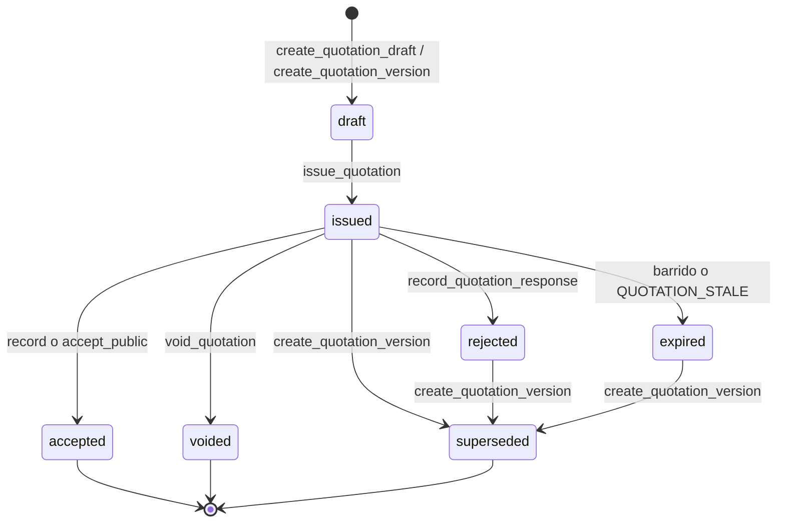

# Data Model: 005-quotation-proposals

Extiende 001 (`audit.log_event`, `set_updated_at`, `require_tenant_admin`), 002 (`pricing_schemes`, `resolve_price`, `add_ons.unit`), 003 (`customers`, `organization_sequences`, `next_organization_sequence`, `require_tenant_member`) y 004 (`pre_reservations`, `pre_reservation_items`, `assert_pre_reservation_quotable`). Migraciones `042`–`048`. No modifica `035`–`041`.

Hoy de calendario y de vigencia: `America/Bogota`, igual que 004. Los instantes de vigencia se guardan en `timestamptz`.

## Enums (`042_quotation_enums.sql`)

```sql
CREATE TYPE public.quotation_status AS ENUM (
  'draft', 'issued', 'accepted', 'rejected', 'expired', 'voided', 'superseded'
);
CREATE TYPE public.quotation_adjustment_direction AS ENUM ('discount', 'surcharge');
CREATE TYPE public.quotation_adjustment_kind AS ENUM ('percent', 'amount');
CREATE TYPE public.quotation_response_kind AS ENUM ('accepted', 'rejected', 'changes_requested');
CREATE TYPE public.quotation_response_origin AS ENUM ('customer', 'agent');
```

| Valor | Etiqueta |
|-------|----------|
| `draft` | Borrador |
| `issued` | Emitida |
| `accepted` | Aceptada |
| `rejected` | Rechazada |
| `expired` | Expirada |
| `voided` | Anulada |
| `superseded` | Superada por nueva versión |
| `discount` / `surcharge` | Descuento / Suplemento |
| `percent` / `amount` | Porcentaje / Monto fijo |
| `changes_requested` | Requiere modificaciones |
| `customer` / `agent` | Cliente / Agente |

`ALTER TYPE audit.audit_event_type ADD VALUE IF NOT EXISTS` para: `quotation_created`, `quotation_issued`, `quotation_adjustment_applied`, `quotation_response_recorded`, `quotation_superseded`, `quotation_voided`, `quotation_expired`. Esos valores no se usan en `042`.

## 1. Family — `public.quotation_families` (`043`)

Agrupa referencia, token y pre-reserva. No es una versión.

| Field | Type | Null | Default | Notes |
|-------|------|------|---------|-------|
| `id` | `uuid` | NO | `gen_random_uuid()` | PK |
| `organization_id` | `uuid` | NO | — | FK → `organizations` |
| `pre_reservation_id` | `uuid` | NO | — | FK compuesta → `pre_reservations(id, organization_id)` |
| `customer_id` | `uuid` | NO | — | FK compuesta → `customers`; copiado de la pre-reserva |
| `reference` | `text` | YES | — | `COT-00001`, se asigna al emitir la v1 |
| `public_token_hash` | `text` | YES | — | SHA-256 hex; null hasta emitir |
| `created_by` | `uuid` | YES | — | FK → `user_profiles(id)` `ON DELETE SET NULL` |
| `created_at` | `timestamptz` | NO | `now()` | |

**Constraints**

- `UNIQUE (id, organization_id)`
- `UNIQUE (organization_id, reference)` donde `reference IS NOT NULL` (índice único parcial)
- `UNIQUE (public_token_hash)` donde no es null
- `reference` nulo o `^COT-[0-9]{5}$`
- Trigger `quotation_families_prevent_identity_change`: `pre_reservation_id`, `customer_id`, `created_at` inmutables → `VALIDATION_ERROR`. `reference` y `public_token_hash` solo pasan de null a valor.

## 2. Version — `public.quotation_versions` (`043`)

La cotización que ve el agente y, si está vigente, el cliente.

| Field | Type | Null | Default | Notes |
|-------|------|------|---------|-------|
| `id` | `uuid` | NO | `gen_random_uuid()` | PK |
| `organization_id` | `uuid` | NO | — | |
| `family_id` | `uuid` | NO | — | FK compuesta → `quotation_families` |
| `version_number` | `smallint` | NO | — | ≥ 1 |
| `status` | `quotation_status` | NO | `'draft'` | |
| `currency` | `char(3)` | NO | — | ISO 4217 de la organización |
| `subtotal` | `numeric(14,2)` | NO | `0` | suma de `line_base` |
| `tax_total` | `numeric(14,2)` | NO | `0` | |
| `adjustment_total` | `numeric(14,2)` | NO | `0` | suma con signo |
| `total` | `numeric(14,2)` | NO | `0` | |
| `exchange_rates` | `jsonb` | NO | `'{}'` | `{ "USD": 4100.00 }` congelado al emitir |
| `party_adults` | `smallint` | NO | `1` | máximo de las líneas |
| `party_children` | `smallint` | NO | `0` | |
| `inclusions` | `text` | NO | `''` | ≤ 4000 |
| `exclusions` | `text` | NO | `''` | ≤ 4000 |
| `terms` | `text` | NO | `''` | ≤ 8000 |
| `commercial_notes` | `text` | YES | — | ≤ 2000, solo panel |
| `valid_until` | `timestamptz` | YES | — | obligatorio al emitir |
| `issued_at` / `issued_by` | | YES | — | |
| `accepted_at` | `timestamptz` | YES | — | |
| `rejected_at` | `timestamptz` | YES | — | |
| `expired_at` | `timestamptz` | YES | — | |
| `voided_at` / `voided_by` | | YES | — | |
| `void_reason` | `text` | YES | — | 1–500 |
| `superseded_at` | `timestamptz` | YES | — | |
| `pre_reservation_fingerprint` | `jsonb` | YES | — | se llena al emitir |
| `response_origin` | `quotation_response_origin` | YES | — | solo si accepted o rejected |
| `created_by` | `uuid` | YES | — | |
| `created_at` / `updated_at` | `timestamptz` | NO | `now()` | `set_updated_at()` |

**Constraints**

- `UNIQUE (id, organization_id)`, `UNIQUE (family_id, version_number)`
- Índice único parcial `(family_id) WHERE status IN ('draft','issued')`
- Índice único parcial `(family_id) WHERE status = 'accepted'`
- `total >= 0`, importes coherentes con el estado: `issued` exige `issued_at`, `valid_until`, `pre_reservation_fingerprint`; `voided` exige motivo; `superseded` exige `superseded_at`
- Moneda `^[A-Z]{3}$`
- Trigger: en estado distinto de `draft`, rechazar cambios de importes, textos comerciales, `exchange_rates` y `valid_until` → `QUOTATION_FROZEN`

## 3. Line — `public.quotation_lines` (`043`)

| Field | Type | Null | Notes |
|-------|------|------|-------|
| `id` | `uuid` | NO | PK |
| `organization_id` | `uuid` | NO | |
| `version_id` | `uuid` | NO | FK compuesta → `quotation_versions` |
| `pre_reservation_item_id` | `uuid` | NO | FK compuesta → `pre_reservation_items` |
| `position` | `smallint` | NO | |
| `item_kind` | `text` | NO | experience, accommodation, package, addon |
| `item_label` | `text` | NO | instantánea ≤ 255 |
| `product_id` / `addon_id` | `uuid` | YES | uno solo, copiados |
| `start_date` / `end_date` | `date` | | |
| `adults` / `children` / `quantity` | `smallint` | NO | |
| `charge_type` | `charge_type` | NO | |
| `charge_basis` | `numeric(12,2)` | NO | > 0 |
| `tariff_currency` | `char(3)` | NO | |
| `tariff_amount` | `numeric(12,2)` | NO | ≥ 0, antes de tasa |
| `exchange_rate` | `numeric(14,6)` | YES | null si la moneda coincide |
| `unit_price` | `numeric(14,2)` | NO | ya en moneda de la cotización |
| `tax_rate` | `numeric(5,2)` | NO | default 0, 0–100 |
| `line_base` / `line_adjustment` / `line_tax` / `line_total` | `numeric(14,2)` | NO | |
| `created_at` | `timestamptz` | NO | |

`UNIQUE (version_id, pre_reservation_item_id)`.

## 4. Adjustment — `public.quotation_adjustments` (`043`)

| Field | Type | Null | Notes |
|-------|------|------|-------|
| `id` | `uuid` | NO | PK |
| `organization_id` | `uuid` | NO | |
| `version_id` | `uuid` | NO | FK |
| `pre_reservation_item_id` | `uuid` | YES | null = global |
| `label` | `text` | NO | 1–80 |
| `direction` | `quotation_adjustment_direction` | NO | |
| `kind` | `quotation_adjustment_kind` | NO | |
| `value` | `numeric(12,2)` | NO | > 0; si `percent`, ≤ 100 |
| `created_by` | `uuid` | YES | |
| `created_at` | `timestamptz` | NO | |

`UNIQUE (version_id, pre_reservation_item_id, label)`.

## 5. Response — `public.quotation_responses` (`043`)

Append-only. Triggers de UPDATE/DELETE/TRUNCATE reutilizan `public.reject_request_note_mutation()`.

| Field | Type | Null | Notes |
|-------|------|------|-------|
| `id` | `bigint` | NO | identity |
| `organization_id` | `uuid` | NO | |
| `version_id` | `uuid` | NO | |
| `kind` | `quotation_response_kind` | NO | |
| `origin` | `quotation_response_origin` | NO | |
| `created_by` | `uuid` | YES | null si origin = customer |
| `created_at` | `timestamptz` | NO | |

## 6. Defaults — `public.quotation_defaults` (`043`)

Una fila por organización. `terms_template text` ≤ 8000. Si no hay fila, el borrador copia el texto fijo de R-009 en `044`: la propuesta vale hasta la fecha indicada, sujeta a disponibilidad, y no es reserva ni factura.

## RLS (`043`)

Todas las tablas: `ENABLE ROW LEVEL SECURITY`, `REVOKE ALL` a `anon`, `GRANT SELECT` a `authenticated`, sin políticas de escritura. Política `SELECT` con `organization_id = (auth.jwt() ->> 'organization_id')::uuid`. `quotation_responses` igual. `anon` no tiene `SELECT`.

## View `public.quotation_list` (`043`)

`security_invoker`, `REVOKE ALL` a `anon`, `GRANT SELECT` a `authenticated`.

Columnas: `version_id`, `family_id`, `organization_id`, `reference`, `version_number`, `status`, `customer_id`, `customer_first_name`, `customer_last_name`, `customer_is_anonymized`, `pre_reservation_id`, `pre_reservation_reference`, `currency`, `total`, `valid_until`, `issued_at`, `created_at`, `created_by`, `agent_name`.

No incluye correo, teléfono ni token.

## Functions

### Núcleo (`044_quotation_pricing.sql`)

| Function | Grants | Behavior |
|----------|--------|----------|
| `resolve_quotation_tariff(...)` | interna | R-002. Devuelve moneda, monto, `charge_type`, origen `season`/`base`. |
| `recalculate_quotation_core(p_org, p_version_id)` | interna | R-001–R-005. Solo `draft`. |
| `quotation_adjustment_impact(...)` | interna | dinero absoluto de los ajustes. |
| `capture_pre_reservation_fingerprint(p_org, p_pre_reservation_id)` | interna | R-004. |

`REVOKE ALL` a `PUBLIC`, `anon`, `authenticated`.

### US1 (`045_us1_quotation_draft.sql`)

| RPC | Guard | Resultado |
|-----|-------|-----------|
| `create_quotation_draft(p_pre_reservation_id uuid)` | `require_tenant_member` | Familia + v1 `draft`, o la familia abierta si ya existe un borrador. |
| `recalculate_quotation(p_version_id uuid)` | member | Desglose. |
| `set_quotation_line_tax(p_line_id uuid, p_tax_rate numeric)` | member | 0–100 y recalcula. |
| `set_quotation_exchange_rate(p_version_id uuid, p_currency char(3), p_rate numeric)` | member | Tasa > 0 y recalcula. |
| `set_quotation_texts(p_version_id uuid, p_inclusions text, p_exclusions text, p_notes text)` | member | Solo borrador. |
| `upsert_quotation_adjustment(...)` | member; admin si supera el tope o la versión no es la primera emisión de la familia | Recalcula. |
| `delete_quotation_adjustment(p_adjustment_id uuid)` | member | Solo borrador. |

### US2 (`046_us2_quotation_issue.sql`)

| RPC | Guard | Resultado |
|-----|-------|-----------|
| `set_quotation_terms(p_version_id uuid, p_terms text, p_valid_until timestamptz)` | member | Valida el tope de R-006. `p_valid_until` null restaura el default. |
| `issue_quotation(p_version_id uuid)` | member | Congela, asigna `COT-#####` si v1, genera token si el hash es null, guarda huella. |
| `expire_due_quotations()` | member | Barrido del tenant. Devuelve `{ expired_count }`. |
| `upsert_quotation_defaults(p_terms text)` | `require_tenant_admin` | Plantilla. |

### US3 (`047_us3_quotation_delivery.sql`)

| RPC | Guard | Resultado |
|-----|-------|-----------|
| `get_public_quotation(p_token text)` | `anon`, `authenticated` | R-008. Sin PII. |
| `quotation_whatsapp_text(p_version_id uuid)` | member | Texto listo para copiar. Solo versión `issued`, `accepted`, `rejected` o `expired`. |

### US4 (`048_us4_quotation_responses.sql`)

| RPC | Guard | Resultado |
|-----|-------|-----------|
| `record_quotation_response(p_version_id uuid, p_kind quotation_response_kind)` | member | `accepted` revalida; `changes_requested` no cambia el estado. |
| `accept_public_quotation(p_token text, p_confirmed boolean)` | `anon`, `authenticated` | Exige `p_confirmed`. Origen `customer`. |
| `create_quotation_version(p_version_id uuid)` | member | Nueva versión `draft` recalculada. |
| `void_quotation(p_version_id uuid, p_reason text)` | admin | Motivo 1–500. No si `accepted`. |
| `assert_quotation_confirmable(p_org uuid, p_version_id uuid)` | interna | R-010. Para 006. |

## State transitions



`changes_requested` no aparece: es una fila de `quotation_responses` mientras el estado sigue `issued`.

## Integration

- **004**: toda mutación que depende de disponibilidad llama a `assert_pre_reservation_quotable`. La vigencia no pasa de `pre_reservations.expires_at`.
- **006**: leerá `assert_quotation_confirmable`. Esta feature no crea filas de reserva.
- **009**: las inclusiones en español de una ficha publicada se copian al borrador. El precio de vitrina no se usa; el precio sale de `pricing_schemes`.
