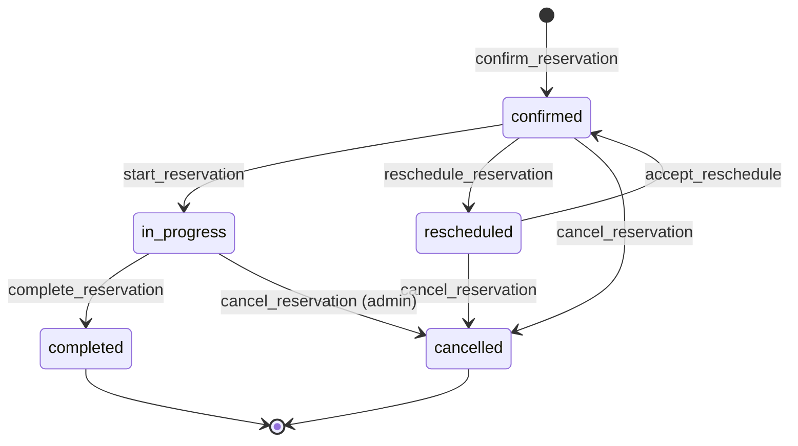

# Data Model: 006-reservation-lifecycle

Depende de 005 (`assert_quotation_confirmable`, `quotation_versions`, `quotation_lines`) y de 001 (`require_tenant_member`, `require_tenant_admin`, `audit.log_event`). Operador: `require_catalog_manager` (ya exige operator o admin). Migraciones `049`–`055`. No modifica `035`–`048`.

## Enums (`049_reservation_enums.sql`)

```sql
CREATE TYPE public.reservation_status AS ENUM (
  'confirmed', 'in_progress', 'completed', 'cancelled', 'rescheduled'
);
CREATE TYPE public.reservation_item_status AS ENUM (
  'confirmed', 'in_service', 'completed', 'incident', 'provider_failed', 'cancelled'
);
CREATE TYPE public.payment_method AS ENUM ('transfer', 'cash', 'card', 'other');
CREATE TYPE public.reservation_event_kind AS ENUM (
  'confirmed', 'status_changed', 'rescheduled', 'provider_replaced',
  'payment_recorded', 'deposit_waived', 'service_order_transmitted', 'passengers_updated'
);
```

| Valor | Etiqueta |
|-------|----------|
| `confirmed` | Confirmada |
| `in_progress` | En ejecución |
| `completed` | Completada |
| `cancelled` | Cancelada |
| `rescheduled` | Reprogramada |
| `provider_failed` | Proveedor incumplido |
| `transfer` / `cash` / `card` / `other` | Transferencia / Efectivo / Tarjeta / Otro |

Auditoría, un `ADD VALUE` por cada uno: `reservation_confirmed`, `reservation_status_changed`, `reservation_cancelled`, `reservation_rescheduled`, `reservation_provider_replaced`, `reservation_payment_recorded`, `reservation_deposit_waived`, `service_order_transmitted`.

## 1. Settings — `public.reservation_settings` (`050`)

| Field | Type | Null | Default | Notes |
|-------|------|------|---------|-------|
| `organization_id` | `uuid` | NO | — | PK, FK → `organizations` |
| `deposit_percent` | `numeric(5,2)` | NO | `30` | 0–100 |
| `assistance_phone` | `text` | YES | — | ≤ 40 |
| `updated_at` | `timestamptz` | NO | `now()` | |

Si no hay fila, el núcleo usa 30 y teléfono null.

## 2. Reservation — `public.reservations` (`050`)

| Field | Type | Null | Notes |
|-------|------|------|-------|
| `id` | `uuid` | NO | PK |
| `organization_id` | `uuid` | NO | |
| `locator` | `text` | NO | `^RSV-[0-9A-HJKMNP-TV-Z]{6}$` |
| `quotation_version_id` | `uuid` | NO | FK compuesta → `quotation_versions` |
| `quotation_family_id` | `uuid` | NO | |
| `pre_reservation_id` | `uuid` | NO | copiado, sin FK que obligue a actualizarla |
| `customer_id` | `uuid` | NO | FK compuesta → `customers` |
| `status` | `reservation_status` | NO | `confirmed` |
| `currency` | `char(3)` | NO | |
| `total` | `numeric(14,2)` | NO | congelado |
| `deposit_percent` | `numeric(5,2)` | NO | copiado al confirmar |
| `deposit_due` | `numeric(14,2)` | NO | |
| `party_adults` / `party_children` | `smallint` | NO | |
| `travel_start` / `travel_end` | `date` | NO / YES | |
| `terms` | `text` | NO | copia de la cotización, ≤ 8000 |
| `responsible_agent_id` | `uuid` | NO | el que confirma |
| `cancel_reason` | `text` | YES | 1–500 |
| `refund_percent` | `numeric(5,2)` | YES | |
| `refund_amount` | `numeric(14,2)` | YES | |
| `contingency_report` | `text` | YES | 1–2000, solo cancelación en ejecución |
| `cancelled_at` / `cancelled_by` | | YES | |
| `confirmed_at` | `timestamptz` | NO | `now()` |
| `created_at` / `updated_at` | `timestamptz` | NO | |

`UNIQUE (organization_id, locator)`. Índice único parcial `(quotation_version_id) WHERE status <> 'cancelled'`. Trigger: `locator`, `quotation_version_id`, `customer_id`, `currency`, `confirmed_at` inmutables.

## 3. Passenger — `public.reservation_passengers` (`050`)

`id`, `organization_id`, `reservation_id`, `position`, `first_name`, `last_name` (1–80), `document_type` y `document_number` opcionales (≤ 40), `birth_date` opcional, `special_requirements` opcional (≤ 500).

## 4. Item — `public.reservation_items` (`050`)

Copia de la línea: `quotation_line_id`, `item_kind`, `item_label`, `product_id`, `addon_id`, `provider_id`, `provider_name`, `start_date`, `end_date`, `quantity`, `line_total` (informativo, no se re-suma para cambiar `reservations.total`), `status reservation_item_status` default `confirmed`, `replaces_item_id` nullable.

## 5. Payment — `public.reservation_payments` (`050`)

`amount` > 0 salvo exención, en cuyo caso `amount = 0` y `waiver_reason` 1–500. `method`, `paid_on date`, `reference` 1–80, `receipt_path` opcional, `recorded_by`. Check: exención y monto positivo no se mezclan.

## 6. Service order — `public.service_orders` (`050`)

`reservation_id`, `provider_id` nullable si el servicio no tiene proveedor (entonces una orden «Sin proveedor»), `body text`, `transmitted_at`, `transmitted_by`. `UNIQUE (reservation_id, provider_id)`.

## 7. Event — `public.reservation_events` (`050`)

Append-only con `reject_request_note_mutation`. `event_kind`, `from_status`, `to_status`, `notes` (motivo u informe; no se copia a auditoría), `actor_id`, `created_at`.

## RLS y vista (`050`)

`SELECT` autenticado por `organization_id`. Sin escrituras directas. `anon` sin privilegios. Vista `reservation_list` (`security_invoker`): `id`, `organization_id`, `locator`, `status`, `customer_first_name`, `customer_last_name`, `customer_is_anonymized`, `travel_start`, `travel_end`, `currency`, `total`, `paid_amount`, `balance`, `quotation_reference`, `confirmed_at`. Sin documentos ni teléfono del cliente.

`paid_amount` = suma de pagos no exentos. `balance` = `greatest(total - paid_amount, 0)`.

## Bucket (`050`)

Mismo stub de `storage` que `026_catalog_media_bucket.sql` si el esquema no existe. Bucket `reservation-receipts`, `public = false`, límite 10 MB, MIME `image/jpeg`, `image/png`, `application/pdf`. Políticas: `authenticated` inserta y lee solo objetos cuyo primer segmento de `name` es su `organization_id`.

## Functions

### Núcleo (`051_reservation_core.sql`)

Internas, sin `GRANT` a `anon` ni `authenticated`:

- `allocate_reservation_locator(p_org uuid) → text`
- `reservation_deposit_due(p_org uuid, p_total numeric) → numeric`
- `assert_passenger_count(p_expected int, p_passengers jsonb)`

### US1 (`052_us1_reservation_confirm.sql`)

| RPC | Guard |
|-----|-------|
| `confirm_reservation(p_quotation_version_id uuid, p_passengers jsonb, p_payment jsonb)` | `require_tenant_member`. Admin si `p_payment.waive` es true |
| `register_reservation_payment(p_reservation_id uuid, p_payment jsonb)` | member, reserva no cancelada ni completada |
| `upsert_reservation_settings(p_deposit_percent numeric, p_assistance_phone text)` | admin |
| `update_reservation_passengers(p_reservation_id uuid, p_passengers jsonb)` | member, misma cantidad |

### US2 (`053_us2_reservation_lifecycle.sql`)

| RPC | Guard | Transición |
|-----|-------|------------|
| `start_reservation(p_reservation_id uuid)` | `require_catalog_manager` | `confirmed` → `in_progress` |
| `complete_reservation(p_reservation_id uuid)` | `require_catalog_manager` | `in_progress` → `completed` |

### US3 (`054_us3_reservation_changes.sql`)

| RPC | Guard |
|-----|-------|
| `cancel_reservation(p_reservation_id uuid, p_reason text, p_refund_percent numeric, p_contingency text)` | member si confirmed/rescheduled; admin si in_progress (`p_contingency` obligatorio) |
| `reschedule_reservation(p_reservation_id uuid, p_travel_start date, p_travel_end date, p_reason text)` | operator |
| `accept_reschedule(p_reservation_id uuid)` | operator, rescheduled → confirmed |
| `mark_item_provider_failed(p_item_id uuid, p_note text)` | operator |
| `add_replacement_item(p_item_id uuid, p_provider_id uuid, p_label text, p_start date, p_end date)` | operator. No cambia `total` |
| `adjust_reservation_total(p_reservation_id uuid, p_total numeric, p_reason text)` | admin |

### US4 (`055_us4_service_orders.sql`)

| RPC | Guard |
|-----|-------|
| `build_service_order(p_reservation_id uuid, p_provider_id uuid)` | operator. `p_provider_id` null agrupa servicios sin proveedor |
| `mark_service_order_transmitted(p_order_id uuid)` | operator |

## Transitions


